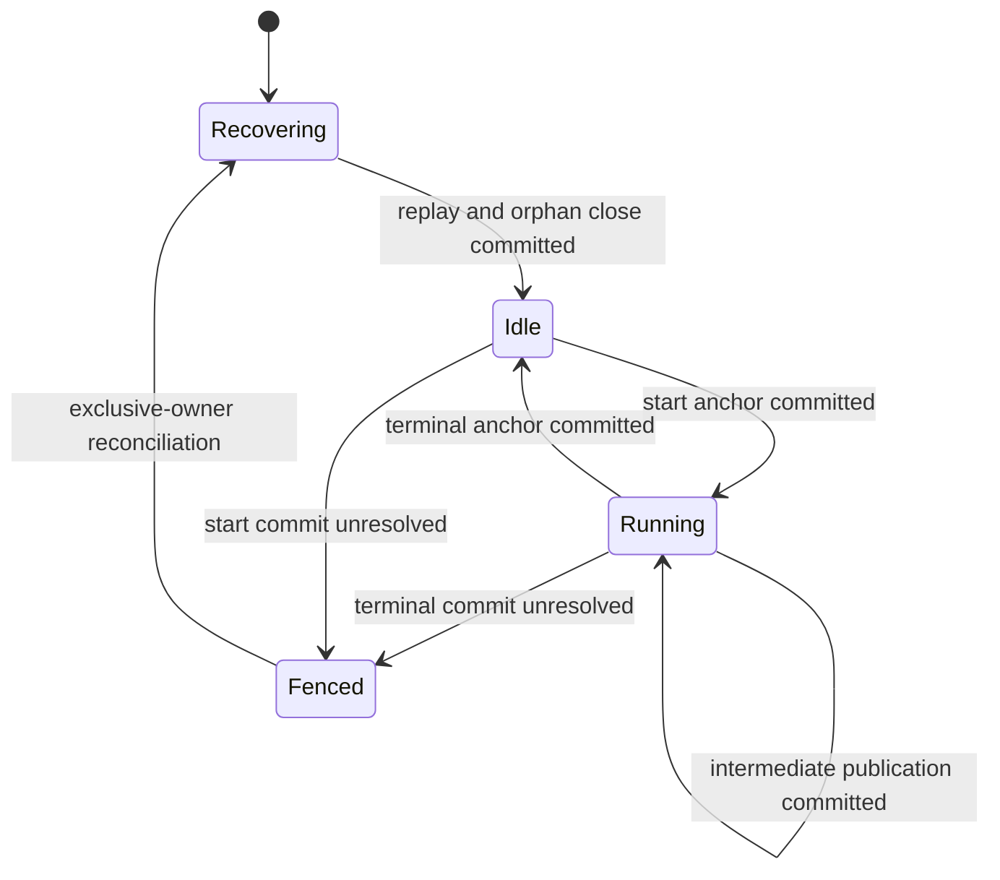
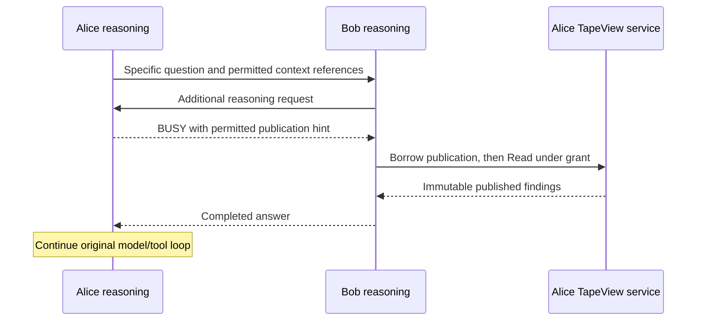

# Anchor-backed execution and peer collaboration

Status: implemented for final-answer publication; tracked in [issue #5](https://github.com/scbizu/anra/issues/5).
The optional intermediate `publish_context` tool is reserved for a later change.
Read the [implementation guide](anchor-busy-implementation-guide.md) with this spec.

## 1. Decision and scope

An agent owns one append-only tape and admits one reasoning invocation at a time.
It records admission and termination as custom anchors on that tape. Another
reasoning request receives a structured BUSY response while an invocation is
active. The response can identify published context that the caller may request
through the permissioned TapeView service without entering the busy runtime.

The tape is the durable execution history. A small in-process admission gate
serializes changes to that history; it is not a second durable task store.

Every incoming agent question enters the recipient's model/tool loop. Consulting
a peer is a deliberate tool call with a specific question. A peer's result,
including BUSY, becomes input to the caller's continuing reasoning. There is no
automatic forwarding, broadcast, background task queue, or automatic polling.

This change belongs to Anra. Tape-go continues to provide storage, anchors,
views, and the ADK integration. Credentials and application configuration remain
Anra concerns; this proposal adds no global peer token.

### Included

- Durable busy and terminal anchors; publication at explicit safe boundaries.
- Nonblocking reasoning admission and typed peer outcomes.
- Borrowing a permitted publication while its owner is reasoning.
- Requester-bound grants, restart recovery, and bounded delegation.
- Removal of the source-agent forwarding bypass.

### Excluded

- Concurrent model runs against the same agent conversation.
- An asynchronous execution scheduler, mailbox, or independently persisted tasks.
- Automatic resumption of interrupted model/tool execution.
- Exactly-once external side effects or an exactly-once remote answer protocol.
- Compaction, archive deletion, multi-process writers, and hostile-peer defenses.
- Returning private model reasoning or arbitrary raw tape extensions to peers.

## 2. Pre-change implementation and failure

The baseline inspected before implementation used tape-go `v0.2.0-anra.2`, ADK `v1.4.0`, and the
A2A Go SDK `v2.5.0`. Check these APIs again if dependencies change.

`Anra.Run` in `pkg/agent/runtime.go` holds `a.mu` for the entire ADK run.
`send_peer_message` in `pkg/a2a/peer_tools.go` synchronously calls the recipient's
A2A endpoint, whose executor calls that recipient's `Run`.

A deadlock follows when Alice waits for Bob and Bob calls Alice. Alice's second
invocation waits for her first invocation's mutex. The local model-turn limit
cannot help while a tool call is blocked. Separate top-level invocations on
Alice and Bob can cause the same problem, without a cycle in either individual
request's ancestry.

`ask` enters the model loop, so it has this concurrency problem. The custom
`/anra/send` endpoint additionally bypasses the source model through `Exchange`.
It must not remain a way to bypass the admission protocol.

The existing borrowing service already provides requester-bound grants,
immutable source references, range checks, pagination, expiry, and release.
However, it currently selects against the live tape head, and `TextExporter`
exports only user/assistant entries. Neither condition is sufficient to export
arbitrary intervals containing the proposed control anchors.

## 3. Terms and invariants

| Term | Meaning |
| --- | --- |
| Source | Stable external `{agentId, tapeId}` identity for one tape incarnation. A registry lease or process restart does not change it. |
| Entry reference | Source plus a canonical decimal tape sequence. In the current storage API `GetID()` is the sequence; there is no separate anchor counter. |
| Invocation | One admitted execution of the existing ADK model/tool loop, identified by a UUID. It is not an A2A task. |
| Owner epoch | A fresh UUID for the process that currently owns the open tape. Used to distinguish recovery from a live invocation. |
| Publication | An immutable, explicitly shareable projection attached to a custom anchor. It contains completed findings and their source coverage. |
| BUSY | New reasoning was not admitted. It is not a successful answer and does not enqueue the request. |

`E17`, `E18`, and `E25` below are illustrative labels for entries at sequences
17, 18, and 25. Anchors occupy ordinary tape sequences.

Normative invariants:

1. At most one invocation is active for an agent's tape/session.
2. An invocation must have a committed start anchor before its first user entry
   or model call. A rejected request appends neither a start anchor nor a user
   entry to that conversation.
3. A terminal anchor references exactly one start anchor. Terminal records are
   appended, never used to edit the start anchor in place.
4. No reasoning admission, borrowing operation, or close operation waits for a
   peer's reasoning while holding a local admission/projection lock.
5. BUSY is a valid result even when no context reference may be disclosed.
6. A context reference is neither a grant nor permission to expand a range.
7. Unpublished or unfinished entries are not made exportable by a busy response.
8. A reported successful run has a committed terminal anchor. Storage ambiguity
   fails closed; it must not silently reopen admission.
9. The agent may cache tape projections, but caches must be reconstructible.
10. Empty or malformed control records cannot be interpreted as idle state.

## 4. Anchor records

### 4.1 Representation

Use tape-go `anchor:custom` entries with a JSON payload whose `schema` is
`anra.dev/anchor/v1`. Do not use `anchor:handoff` for admission: tape-go gives
handoff anchors summarization/archive and rewind semantics.

Do not assign a sequence before append. Create the entry with a zero ID and use
`Store`'s returned entry to obtain its actual ID and timestamp. The storage
assigns sequences atomically. Payload references point to earlier entries and
must not require predicting the current entry's sequence.

All examples show application JSON, not protobuf JSON. Sequence values remain
canonical arbitrary-precision decimal strings. Never narrow them to `uint64`.

For a new tape that has no stable source identity, an initialization record may
use the same schema with `type: "tape.initialized"` and a required `source` object.
It is created once under exclusive ownership, is not exportable, and does not
start an invocation. A later owner reuses it. Conflicting identities fail startup;
an existing source bound to a grant journal must be reconciled, not replaced.

### 4.2 Start anchor: the busy interval begins

```json
{
  "schema": "anra.dev/anchor/v1",
  "type": "invocation.started",
  "invocationId": "invocation-uuid",
  "ownerEpoch": "process-uuid",
  "basePublication": {
    "source": {"agentId": "alice", "tapeId": "tape-uuid"},
    "seq": "17"
  }
}
```

`invocationId` and `ownerEpoch` are required. `basePublication` is optional and
references the latest committed publication when admission occurs. The start
anchor's own sequence, for example `E18`, identifies the busy interval.

Caller identity, a request correlation ID, and the effective deadline may be
recorded as bounded local diagnostic fields. They are not exported by default.
An A2A `contextId` or `taskId` must never select the local tape owner.

### 4.3 Publication during an invocation

```json
{
  "schema": "anra.dev/anchor/v1",
  "type": "context.published",
  "invocationId": "invocation-uuid",
  "startSeq": "18",
  "publication": {
    "summary": "Completed, shareable findings relevant to the storage question.",
    "covers": [{"seqS": "19", "seqE": "22"}],
    "sourceHead": "21"
  }
}
```

The publication is complete and immutable at commit. `covers` uses half-open
source ranges, all ending at or before `sourceHead + 1`; `sourceHead` precedes
the publication entry. Coverage is provenance, not a grant to read those ranges.
No promised tool result, partial output, or raw private reasoning belongs in
`summary`. A publication with no useful findings must not be manufactured merely
to supply a busy hint.

Initial implementation may publish final answers only. To publish intermediate
findings, add a fixed built-in `publish_context` tool, taking a bounded summary
and coverage references. The runtime validates coverage and sharing eligibility
and persists the anchor before reporting success to the model. This does not
allow tool injection. It does not reset the active context window or archive
older entries.

A publication remains valid after a later failure if it was explicitly committed
before that failure. Failure does not retroactively publish the remaining tail.

### 4.4 Terminal anchor

```json
{
  "schema": "anra.dev/anchor/v1",
  "type": "invocation.closed",
  "invocationId": "invocation-uuid",
  "startSeq": "18",
  "outcome": "completed",
  "publication": {
    "summary": "The final shareable answer.",
    "covers": [{"seqS": "25", "seqE": "26"}],
    "sourceHead": "25"
  }
}
```

Allowed outcomes: `completed`, `failed`, `cancelled`, and `abandoned`.
`publication` is optional and allowed only for a successfully completed run.
A successful terminal anchor may also be its final publication, so closing the
invocation and publishing its final findings require one atomic append rather
than two appends with a crash window between them. Eligible final answers publish
by default within the export size limits. No bootstrap sharing option is needed;
trusted-peer identity and requester-bound TapeView grants govern borrowing the
published projection. Oversized answers complete without a publication.

Failure details use bounded stable codes, not raw provider errors, credentials,
or arbitrary prompt content. An abandoned close identifies the recovering epoch
locally. Duplicate closes are prevented by the serialized control path; recovery
must first reconcile committed records before attempting another close.

### 4.5 Example tape

```text
E17  anchor:custom  committed publication
E18  anchor:custom  invocation.started X, basePublication=E17
E19  user          incoming question
E20  assistant     peer tool call
E21  tool_result   peer response
E22  anchor:custom context.published, completed findings through E21
E23  assistant     further tool call
E24  tool_result   further tool response
E25  assistant     final answer
E26  anchor:custom invocation.closed X, outcome=completed, final publication
```

During X, the active interval is E18 and the latest publication advances from
E17 to E22. After E26, X is closed and E26 may be the latest publication. A
publication must cover an actually complete segment; tool calls and results stay
paired in the local model history.

## 5. Admission and concurrency



BUSY is a response while Running, not a second queued execution state.

### 5.1 Single writer, short control critical section

The supported deployment has one process owning an agent database. The bbolt
file lock provides process-level exclusivity. Every local entry point that can
start reasoning must use the same control object.

A short control mutex serializes: inspect cached/replayed state, append a start
anchor, update the projection, and return admission. Release it before entering
ADK, running a model, calling a tool, or contacting a peer. Keep the active
invocation in the projection while the invocation runs.

If an invocation is active, return BUSY using a committed state snapshot. Do
not wait behind that invocation. A short local storage commit can delay a
control operation; this is not a hard real-time guarantee. Busy handling must
not depend on the duration of a model call, peer call, or grant-policy inference.

There is no unsafe `Get`/`Store` compare-and-swap assumption: the current tape
API does not expose an atomic claim-if-idle operation. The local mutex and the
single-writer ownership make the check and append linearizable for v1. A future
multi-process writer would require a storage-level conditional transaction;
adding more anchors alone would not provide it.

### 5.2 Completion and errors

After ADK returns, reacquire the short control mutex and append the terminal
anchor. Update the projection and permit another run only after commit.

Cancellation cleanup uses a fresh, bounded local context, not the already
cancelled request context. If a close cannot be committed, mark the runtime
unavailable and require reconciliation before admitting more work. Do not
release the agent into an apparently idle state with an unresolved durable start.

Never wait for a peer while holding either the control mutex or a write
transaction. The live invocation may wait on a bounded tool call; incoming
reasoning requests remain able to observe BUSY.

### 5.3 Borrowing does not acquire admission

A borrowing request obtains a snapshot of committed publications and its caller
identity, then works through the grant service. It never requests a reasoning
permit. Selecting a publication while busy must use local committed data and a
bounded policy path. If authorization/selection requires the occupied runtime
to think, return denied/unavailable immediately; do not acquire that runtime or
automatically enqueue a pending reasoning task.

Keep the lock order simple: release control/projection locks before entering the
grant journal. Grant operations must not call back into reasoning admission.
Use a deterministic, local publication selector for v1. Existing custom ranking
policies that make remote/model calls must not be installed on this busy-safe
borrowing path.

## 6. Projection, failures, and restart

Replay recognized Anra custom anchors in sequence order into a projection of:
source identity, active invocation/start, terminal outcomes, committed
publications, and their coverage. The source of truth is the tape; the projection
is replaceable memory. Unrelated tape-go/custom anchors are left alone.

An unsupported version of the Anra anchor schema, a malformed recognized
anchor, an impossible close, or overlapping starts prevents serving until
reconciled. Never silently drop a control anchor and infer idle.

At startup, before accepting HTTP traffic or registering the card:

1. Acquire exclusive database ownership and establish a fresh owner epoch.
2. Load the stable source identity. Reuse the existing tape-incarnation mechanism;
   if absent, introduce one persisted initialization anchor, not a process UUID.
3. Replay the execution/publication projection.
4. For an unmatched start from a previous owner, append `abandoned` under a fresh
   bounded recovery context. A same-epoch unmatched start is not automatically
   abandoned while its goroutine could still be live.
5. Rebuild the ADK session projection and initialize the live admission state.
6. Expose borrowing and reasoning endpoints, then register the Agent Card.

Unfinished records remain on tape. They are not replayed as an automatically
resumed invocation and are not exported by default. Exclude the ADK event
intervals of failed/cancelled/abandoned invocations from subsequent model input,
including their state deltas and unmatched function calls. Rebuild any hydrated
TapeAdapter/session state after abort; filtering only the next prompt is not
enough if partial state was already cached.

Explicit publications inside such an invocation remain available as published
findings. They need not make the abandoned raw event interval part of the next
local conversation. Completed invocations retain their normal conversation
history. This projection rule must be tested against ADK's tool-call/result
pairing requirements.

The pinned TapeAdapter skips anchors in `ContextWindow`, but session loading
also projects stored entries into events. Ensure all Anra control anchors are
excluded from both model contents and ordinary ADK session-event projection.
Use Anra's storage/event adapter seam; do not change `anchor:handoff` behavior.

## 7. Publication borrowing and exact range semantics

### 7.1 A publication is an exportable projection, not a raw interval

The existing v1 grant allows at most one contiguous range. Its reader requires
one exported entry per original sequence; silently skipping control entries
would violate that contract.

For publication-backed borrowing, grant the publication anchor entry itself:
if the publication is at sequence P, the range is `[P, P+1)` and the grant's
`snapshotHead` is P. This gives one contiguous, immutable entry even if its
findings were derived from several noncontiguous private source ranges.

Introduce a deterministic publication exporter. It whitelists the recognized
publication schema and returns only the public summary and provenance coverage.
It preserves the anchor entry's actual sequence, kind, and timestamp, as required
by `Service.entries`. It must not return the raw anchor JSON, owner epoch,
invocation internals, or arbitrary extensions. Busy/start anchors and terminal
anchors without a publication are not exportable by this exporter.

Declare a versioned payload media type, proposed as
`application/vnd.anra.published-context+json;version=1`, and advertise it in the
TapeView extension. Keep existing text exporting for previously supported text
views. Export projections for existing grants must remain stable across upgrades;
retain the versioned exporter for as long as its grants can be read.

`publication.sourceHead` describes the covered findings, which precede P.
`View.snapshotHead` is P because the borrowed object is the publication entry.
These values have different meanings and must not be substituted for each other.
The `covers` references do not authorize follow-up raw-range reads.

A lender advertising publication borrowing adds `publicationBorrowVersion: 1`
to the existing TapeView extension parameters and advertises the publication
payload media type. Clients must require that capability before sending a
publication reference. An older lender must never be used as an implicit
fallback: it might ignore an additive field and select a different live range.
The borrower checks that the granted source, range, and head match requested P
before Read, even when peers are otherwise trusted. A mismatch is a protocol
error, not permission to consume another view.

### 7.2 Add an optional publication reference to Borrow

Extend `proto/anra/a2a/tape/v1/tape.proto` additively:

```proto
message AnchorRef {
  Source source = 1; // required
  string seq = 2;   // positive canonical arbitrary-precision decimal
}

// Existing fields 1..4 are unchanged.
// Add to BorrowRequest:
// AnchorRef publication = 5;
```

Implement these constraints in the protobuf validation rules and service:

- A supplied reference must belong to this lender's source and identify a
  committed publication anchor. Wrong tape incarnations are not substituted.
- The server independently applies caller eligibility/export policy. A reference
  copied from a busy hint is not authorization.
- If `bounds` is also supplied, the single-entry publication range must fit
  inside it; otherwise return `invalid_argument`.
- Without a reference, the selector may choose one eligible committed publication
  by the relevance query. It must not fall back to an unpublished live tail.
- A missing/unavailable requested publication returns a denied decision without
  a view. Invalid syntax/source or incompatible bounds is `invalid_argument`.
- A request ID retried with different publication/bounds remains a conflict.
  Existing identical retries return their recorded decision; no silent upgrade
  to a later publication is allowed.

For publication-backed grants, select/validate using the publication snapshot P,
not the current live head. The immutable view recorded by the journal remains
`[P, P+1)` with head P, even while further reasoning appends entries.

Existing historical raw-range grants remain readable under their original
rules. Do not rewrite or revoke them merely because this feature is enabled.
New busy-safe publication requests use the new eligibility ceiling; legacy
raw-range borrowing remains a separate explicit policy, never an automatic
fallback from BUSY.

### 7.3 Permission and reachability

The deployment restricts the registry and agent endpoints to trusted members.
`Anra-Agent` supplies a stable identity and is not a credential; members are
trusted not to impersonate one another. Grants remain bound to that identity.

Disclose a busy anchor or publication hint only when metadata sharing is allowed.
Do not reveal private summaries, coverage, active caller IDs, or unrelated work
through the BUSY response. The borrower still calls Borrow and Read. Existing
expiry, release, revocation, page bounds, payload limits, and source provenance
continue to apply.

## 8. A2A collaboration result contract

Keep core A2A messaging. Do not add an execution task store or another forwarding
HTTP route. Advertise an Anra collaboration extension with URI
`urn:anra:a2a:collaboration:v1`. Anra peer requests put that URI in the message's
`extensions` and put protocol data under the same key in message `metadata`.
The TapeView RPC opt-in/acknowledgement contract remains unchanged.

Request metadata is the ProtoJSON representation of generated
`anra.a2a.collaboration.v1.DelegationMetadata`:

```json
{
  "rootRequestId": "root-uuid",
  "deadline": "2026-10-24T12:00:00Z",
  "ancestors": ["alice"],
  "context": []
}
```

The application starts a root invocation with a deadline capped by its local
command/runtime limit and an empty ancestry list. Before a peer edge, append the
current agent; do not deduplicate an actual repeated visit. There is no hop
counter or ancestry-length limit. Validate the encoded metadata size, and keep
the existing per-invocation model-turn limit. A peer cannot extend the receiver's
local deadline.

A deadline must be propagated explicitly and capped locally: a Go context's
cancellation/deadline is not automatically a wire deadline across HTTP hops.
Transport cancellation still propagates best effort. Root IDs correlate records;
they do not select ownership or establish trust.

Response metadata is generated `anra.a2a.collaboration.v1.ResponseMetadata`
under the collaboration URI. Answer text remains in standard A2A parts:

```json
{
  "status": "STATUS_BUSY",
  "publication": {
    "source": {"agentId": "alice", "tapeId": "tape-uuid"},
    "seq": "17"
  },
  "retry": "RETRY_HINT_AFTER_NEW_PUBLICATION"
}
```

Wire status values are `STATUS_COMPLETED` and `STATUS_BUSY`.
`STATUS_COMPLETED` has a nonempty text answer.
`STATUS_BUSY` has no answer and has an optional permitted `publication`.
The human-readable text
for BUSY must say the request was not accepted; it is not a fabricated answer.
Malformed messages, invalid identities, model failures, and storage failures
remain errors, not BUSY. Retry metadata is advisory; it is not a queued request
or a timer to start automatically.

The schema defines field sizes, context-reference list limits, valid enums,
and BUSY-only details using Protovalidate. Adapters use ProtoJSON and those
descriptors directly; no handwritten collaboration JSON codecs or legacy format
fallback remain. Runtime deadline caps, path recording, and local
BUSY attempt state stay in Go. Tools render lowercase status labels and retain
`no_new_context` as a local-only result.

Normal generic A2A clients can still send text. They receive normal text answers
or a clear busy/unaccepted message, without Anra-only context references. Anra
clients require the extension for typed peer outcomes and must not infer status
by parsing the human text. Validate that a response from a peer that advertised
and accepted the extension includes valid collaboration metadata; malformed or
missing required metadata is a protocol error.



The core runtime can keep `Run(ctx, input) (string, error)`: return an exported
`ErrBusy` sentinel wrapped in a typed error with a committed busy/publication
snapshot. The A2A executor inspects a narrow details interface rather than
importing `pkg/agent` (which already depends on `pkg/a2a`). Keep the shared anchor
reference in generated protobuf types; do not introduce a new runtime scheduler
package merely to carry this error. Other errors keep their current handling.

`MessageClient.Send` must return a typed collaboration result to peer tools.
The CLI reports BUSY as an unaccepted request, while a model tool receives BUSY
as a structured result so its caller can continue reasoning.

## 9. Caller behavior and bounded progress

`pkg/model/delegator.Delegator` owns the invocation's root, deadline,
ancestry, context hints, and BUSY progress. The A2A layer transports generated
metadata; callers do not maintain a second copy of the delegation state.
`Accept` owns validated inbound metadata. `Begin` starts fresh invocation-local
progress and caps the inherited deadline. `Next` forks a path for one edge,
preserving sibling paths. `Observe` records BUSY outcomes and `Borrowed`
records progress only after a grant is successfully read. Transport-facing
`Metadata` returns an owned snapshot. The model owns its context binding and
mutexes and has no dependency on HTTP, discovery, or the ADK tool system.

`send_peer_message` becomes a reasoning/delegation tool, not a relay. Its result
contains status, the peer identity, an answer only for `completed`, and a permitted
publication hint only when present. ADK persists that result on the caller's tape.

A separate built-in context-borrowing tool accepts a discovered peer name,
request ID, purpose, and query. The lender selects its latest eligible publication
locally, even while busy; no publication selector is exposed to the model. The
tool resolves that peer's advertised TapeView capability and uses the existing
Borrow/Read protocol. Do not assume
that the present `WithBorrowClient` API already discovers and borrows from every
registered peer; wire that capability explicitly.

A request may carry context references so Bob can borrow Alice's relevant
published findings without asking Alice to reason again. A reference must still
lead to a borrow request to the original lender under Bob's own identity; the
lender selects the context to grant. No transitive permission is implied.

In one local invocation, remember every `(peer, publication reference)` that
returned BUSY. A repeated reasoning call to that peer without evidence of a
newer eligible publication returns `no_new_context` locally and does not make
another network call. Treat a busy result without a hint as its own unchanged
state. A changed message alone does not prove new peer progress. A later root
invocation may try again normally. Do not automatically poll while waiting.

The model may request context from that lender, consult a different peer,
continue locally, or report a limitation. Borrowing an unchanged publication does
not permit another reasoning attempt. Determine
progress from the source and snapshot actually granted and read, rather than a
borrower-supplied reference. Ancestor information may guide the model, but
the nonblocking admission rule is what prevents deadlock between independent
roots. If an ancestor is still busy, it returns BUSY; no ancestor bypasses the
gate.

## 10. CLI and server wiring

`ask --agent alice ...` submits a question to Alice's registered runtime. Alice
chooses whether and whom to consult. The registry remains card discovery, not
an execution coordinator or a source of live BUSY truth.

Remove `/anra/send`, `sendFromServer`, and the CLI's forwarding-only `send`
command. Remove `Anra.Exchange` if no supported non-forwarding caller remains.
Do not silently turn `send --to bob` into a prompt that claims Alice has chosen
Bob. Update help and docs to use `ask`; tests must demonstrate source-agent
reasoning and tool selection rather than asserting blind forwarding.

`serve` must mount the TapeView service as well as core A2A, advertise its
capabilities/media types, and own the grant journal lifecycle. The current
messaging-only `NewMessageHandler` setup is not sufficient. Use the existing
peer handler integration with the publication policy/exporter.

Keep provider setup in `pkg/agent` as in the current workspace. This feature
must not reintroduce CLI model wrappers, tool injection, per-peer URLs, a global
peer token, or a second handwritten model/tool loop.

## 11. Failure behavior

| Condition | Required outcome |
| --- | --- |
| Another invocation is active | Immediate BUSY snapshot; no new model call, user entry, or queued task. |
| No publication is eligible | BUSY without a context hint; borrowing denies without leaking the live tail. |
| Start append fails | No model call; reconcile storage ambiguity and fail closed. |
| Model/tool failure or cancellation | Append a nonpublishing terminal record under bounded cleanup; propagate the failure. |
| Terminal append fails | No success acknowledgement; agent unavailable until reconciliation/recovery. |
| Crash after start or during tool use | Next exclusive owner closes the orphan as abandoned; no automatic replay of side effects. |
| Crash after terminal commit, before response delivery | Tape is completed; caller may be uncertain. Do not promise exactly-once retries. |
| Publication append fails | No publication reference is exposed; earlier publications remain valid. |
| Unsupported/corrupt control schema | Fail serving/recovery explicitly; do not infer idle or reset the tape. |
| Repeated BUSY at unchanged publication | Local `no_new_context`, with no repeated peer invocation. |
| Deadline expired or invocation cancelled | Stop the edge without entering the peer; return the context error. |
| Borrower differs from grant owner | Deny Get/Read/Release using existing grant rules. |

## 12. Acceptance contract

Implement executable Given/When/Then scenarios under `tests/e2e/`. Model outputs
are deterministic fixtures; use public APIs, real HTTP, and temporary disk.
Use fixture barriers to control races; do not make correctness depend on sleeps.

1. Two simultaneous callers of an idle agent yield exactly one admitted start;
   the other observes BUSY. Count model calls and inspect the source tape.
2. Alice waits for Bob; Bob calls Alice; Bob receives BUSY and both original
   invocations can finish. Alice does not start a second model loop.
3. Alice and Bob start independent roots and consult each other; both terminate
   within the test deadline without waiting behind another reasoning gate.
4. Bob borrows Alice's published anchor while Alice's model is held at a fixture
   barrier; Borrow/Read completes before releasing that barrier.
5. Publication grants contain exactly `[P, P+1)`, head P, the allowed summary,
   and source coverage. New entries and later publications do not change them.
6. A busy peer with no eligible publication leaks no hint, private metadata, or
   unfinished tool result. A guessed publication reference does not grant access.
7. A different caller cannot read/release a grant. Existing expiry, revocation,
   pagination, extension activation, and provenance scenarios keep their behavior.
8. Intermediate publication and final publication survive restart. Ordinary
   busy/terminal anchors cannot be exported as raw metadata or ADK messages.
9. Unknown source, malformed references, and incompatible bounds fail validation;
   an identical Borrow retry is stable and a changed reference conflicts.
10. A repeated reasoning call to an unchanged busy peer makes only one remote
    invocation attempt in that caller turn. Context borrowing is separately
    recorded and does not cause an automatic retry.
11. Cancellation appends a close even though the request context is cancelled;
    the next request can run. A failed close fences admission instead.
12. Killing a process with an open busy anchor leads to one abandoned close on
    restart, preserves source identity/publications, and permits new work.
13. Recovered failed/abandoned histories do not send unmatched function calls or
    partial state deltas into the next model request. Historical entries remain.
14. A source agent can answer without consulting peers, or deliberately select
    one peer through its tools. No CLI forwarding endpoint bypasses this choice.
15. Plain legacy tapes remain readable, with no automatic permission to export
    their contents and no invented completion records for unknown old history.

Run `mise run test` for build, schema, generated-code, and E2E checks. Temporary
unit checks may aid investigation but remain uncommitted and are removed after
use, in accordance with `AGENTS.md`.

## 13. References and review gates

- [Issue #5](https://github.com/scbizu/anra/issues/5)
- [Implementation guide](anchor-busy-implementation-guide.md)
- [Existing TapeView design](a2a-tape-view-extension-design.md)
- [A2A integration](../a2a-integration.md)
- [Testing policy](../testing.md)
- Source seams: `pkg/agent/{agent,runtime,events,tools}.go`,
  `pkg/a2a/{executor,messaging,peer_tools,service,connect,http}.go`,
  `cmd/{agent,serve,ask,send,outbound}.go`, and
  `proto/anra/a2a/tape/v1/tape.proto`.

Before implementation review, agree on the publication projection, export policy,
and failure-recovery rules. They are correctness boundaries, not optional
observability additions. Protocol numeric field allocation and generated code
must follow the existing Buf workflow; the proposed additive field is number 5.
