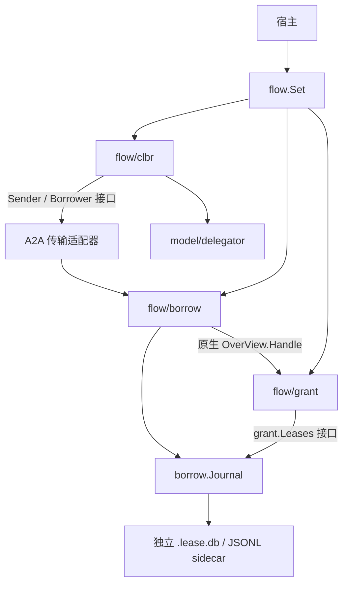

# Borrow、Grant 与 Collaboration 的流程边界

根包 `pkg/flow` 只声明具体流程集合 `Set`，字段为 Borrow、Grant 和 Clbr。宿主组装依赖并拥有原生存储的打开、初始化和关闭。子包不依赖根包；根包不重新导出子包类型或错误，不提供统一 Execute、动态流程注册或通用状态机。

## 职责与依赖

| 包 | 拥有的行为与状态 |
| --- | --- |
| `flow/borrow` | 新请求的 Review、请求幂等、已提交 View 选择、Approve/Reject、完整 Quote 读取、分页，以及唯一的持久化 Journal |
| `flow/grant` | 原生多段 View handler、候选 lease 构建、有效期检查及已提交 lease 的读取/释放能力 |
| `flow/clbr` | 委托调用、BUSY 抑制、已完整借阅后的进度更新、本地运行结果到协作结果的转换 |
| `agent` / `model/delegator` | 原生 Turn 的执行与恢复；不可变委托路径、deadline 与每个 Turn 的 BUSY 记忆 |
| `a2a` / `mcp` / tools | 协议认证、网络与编解码、能力注入、模型参数和输出格式 |

具体 Go 依赖为根包到三个子包、borrow 到 grant；clbr 通过消费方接口使用发送和远端借阅能力，避免反向依赖 A2A 或根包。协作 `Result` 由 clbr 定义，A2A 只负责将其 metadata 编码到协议。`Suppressed` 是本地结果，不成为 wire status。

## 一次授权的提交边界

`grant.Handle` 的命令只有 Caller 和 TTL，目标 Ref 来自完整的原生多段 View。它返回候选 lease，不接收 BorrowRequest、pending 状态、Selection 或 expected 快照，也不写 sidecar。未提交的候选 lease 无法通过正常借阅 API 读取或释放。

`borrow.Journal` 是唯一持久化所有者。初始请求的结果、其中的 lease 和后续释放均使用原有 sidecar 记录格式，一次追加同时作为状态与审计来源。多个服务共享 Journal；其锁覆盖重放、预期快照比较、lease ID 唯一性和追加。候选 lease 与请求结果在同一条记录中提交，无需跨两个存储协调。

grant 通过自己定义的 `Leases` 接口取得已提交快照和原子释放能力，Journal 实现此接口。`borrow.New` 校验其配置的授权服务与请求状态确实使用同一个 Journal。读取与释放的线性化点由共享 Journal 提供；已取得快照许可的读取可以完成，释放后取得的快照必须拒绝。

## 明确的业务操作

- `Borrow` 仅处理首次申请和幂等重放。`Config.Review` 决定初始 granted、pending 或 denied；仅新请求调用 Review。
- `Approve(ctx, caller, id, ttl)` 只批准已有 pending 请求。租期错误、无可用已提交 View 或签发失败均保留 pending，不隐式拒绝。成功后 Journal 在提交时重新核对原快照。
- `Reject(ctx, caller, id)` 只把 pending 请求变为 denied，不调用 Review、不选择 View。
- 已完成请求再次 Approve 或 Reject 均返回冲突。Release/Revoke 幂等，过期仍允许显式释放；grant 用共享时钟计算有效性。

旧的 Resolve、decide 和可空 expected 模式不再存在于业务 API。底层 journal 的条件提交只承担并发和存储不变量。

## 协作调度

`clbr.Service` 零值可用且无进程级状态。Send 先通过 Delegator 检查路径、deadline 和 BUSY 进度，允许后才连接并发送消息；被抑制的调用不访问网络。远端结果由 Delegator 观察。Borrow 通过真实客户端完整读取并验证借阅内容后才清除 BUSY 抑制；拒绝、pending 和失败不产生进度。Run 将原生 runtime 的 BUSY 错误转成未接受的协作结果，执行状态仍由 Agent 管理。

## 验收

使用真实 HTTP 与持久化的中文 E2E 检查：候选 lease 不可读、Approve 缺少 View 时不改 pending、显式 Reject、其他调用方隔离、竞争批准仅一次提交、bbolt/JSONL 重启恢复。既有协作场景验证循环、并行根、deadline、BUSY 抑制与新借阅内容的进度。纯逻辑测试分别验证请求终态、lease 到期、多段范围及来源精度。

本轮验证：`mise run test` 中的协议检查、生成一致性、构建和单元测试通过；race E2E 为 253/254 场景通过，大型多模态场景在原有 20 秒期限处超时，单独运行仍可复现，无 race 报告。未修改期限或断言。不带 race 的完整 `go test -count=1 -v ./tests/e2e` 为 254 个场景、1226 个步骤全部通过，其中大型多模态场景耗时 2.17 秒。相关包 `go vet`、gofumpt 与 `git diff --check` 通过。
