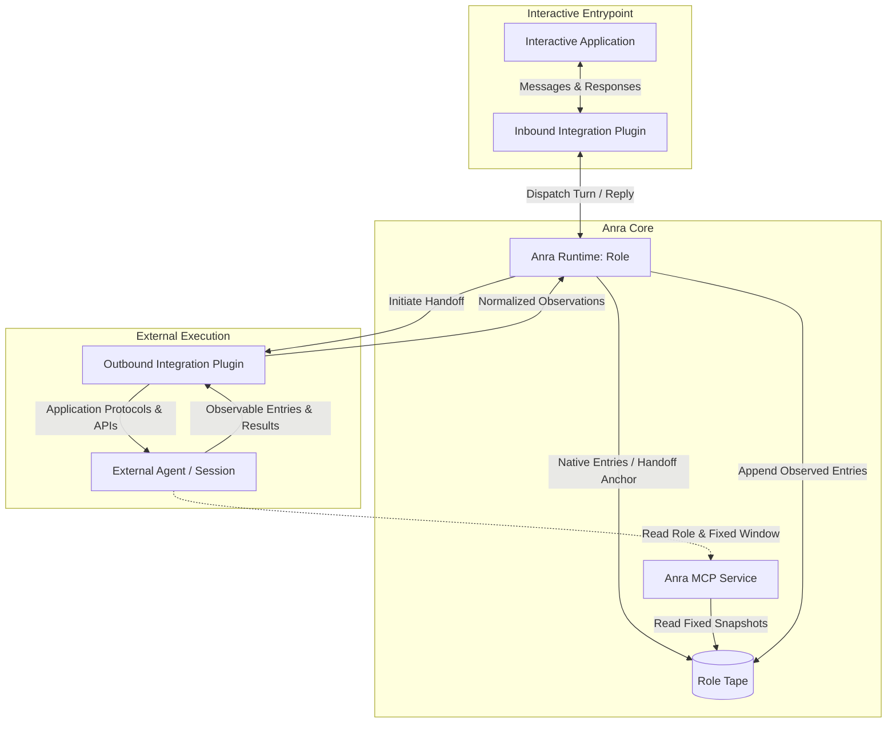
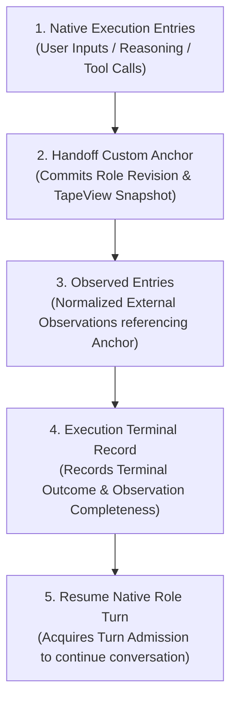

# Plugin Integration Spec

Status: Approved. This document governs how roles operate across integrations and how external experiences commit to Tape. For plugin registration and invocation contracts, see [Plugin Spec](plugin-spec.md). For context reading by external execution environments, see [Anra MCP Spec](anra-mcp-spec.md).

## Scenarios and Domain Model

Anra manages roles and their respective Peer identities. Applications supporting roles can serve as interactive entrypoints; sessions executed by the Anra runtime write directly to the role's Tape. While application configuration provides connection bindings, reading configuration does not imply runtime ownership—an interactive entrypoint must actively deliver inbound messages to Anra and relay responses back to the origin conversation.

When a role converses with users in an interactive application and decides to delegate a specialized task, it initiates an external work session through an integration plugin. The external execution environment retains its own native runtime (e.g., coding agent, sandbox), reading authorized role definitions and fixed context windows via Anra MCP. Throughout this lifecycle, the central identity remains the same Role; external bindings and sessions represent its execution attachments and experiential history.



The two plugins above separately serve as the interactive entrypoint and the external execution adapter. Anra MCP is an independent core service; other integrations are not required to adopt identical transport protocols or tool schemas.

### Concrete Reference Scenario (Vesta / Raft / Lody)

Consider role **Vesta** receiving coding requests via **Raft** and delegating execution to **Lody**:
- Vesta owns a stable Peer identity and local Tape;
- Raft serves as the interactive entrypoint (Inbound Plugin), routing conversation turns to the Anra runtime and receiving final responses upon completion;
- Lody serves as the external execution environment (Outbound Plugin), hosting dedicated coding sessions initiated by Vesta;
- Lody coding agents read authorized context snapshots via Anra MCP and execute autonomously; observations and terminal results are normalized by the plugin and appended back to Vesta's Tape.

## Bindings and Handoffs

A `RoleBinding` associates a Role with an application tenant, stable external identity, `PluginConnection`, and functional purpose. Names serve display purposes only; a single Role can maintain multiple bindings to distinct external systems, each referencing authorized destinations. External execution references belong to the domain of their respective plugins and do not create new Peers. The initial version models one Role to one Peer; Role identifies both the logical persona and the underlying execution subject without implicit cross-role tape merging.

An external task delegation is identified by a handoff custom anchor recorded on the role's Tape. Anra commits this anchor before dispatching work; external execution handles, acceptance status, and observation checkpoints belong to subsequent execution records and never mutate the anchor. A single external session may serve multiple sequential handoffs, with each delegation writing its own unique anchor.

## Handoff Custom Anchor

Handoff records use Tape entry kind `anchor:custom`, with the summary containing the following JSON object. The `schema` uses the versioned integration namespace `anra.dev/anchor/intr/v1`:

```json
{
  "schema": "anra.dev/anchor/intr/v1",
  "type": "integration.handoff",
  "role": { "id": "vesta", "version": "role-revision-42" },
  "target": { "name": "lody", "bindingId": "vesta-lody" },
  "task": "Implement the requested feature",
  "context": {
    "view": {
      "source": { "agentId": "vesta", "tapeId": "tape-id" },
      "snapshotHead": "20",
      "scope": { "seqS": "1", "seqE": "20" }
    }
  },
  "origin": { "name": "raft", "bindingId": "vesta-raft", "sessionId": "session-id", "eventId": "event-id" }
}
```

| Field | Invariants & Constraints |
| --- | --- |
| `schema`, `type` | Required. Fixed to `anra.dev/anchor/intr/v1` and `integration.handoff` respectively. |
| `role.id`, `role.version` | Required. Stable role identifier and reproducible definition version; display names alone are prohibited. |
| `target.name`, `target.bindingId` | Required. Target integration identifier and authorized destination `RoleBinding` ID; target resolved strictly via binding. |
| `task` | Required. Delegated task prompt for the external runtime; credentials strictly forbidden. |
| `context.view` | Required. Immutable `TapeView` reference defining source identity, committed snapshot head, and half-open scope `[seqS, seqE)`. |
| `origin` | Optional provenance link. When present, `name` is required; `bindingId`, `sessionId`, and `eventId` recorded when available without inference. |

### Reference and Persistence Invariants

An anchor's identity is uniquely determined by its Tape identity and entry sequence (`Seq`). Subsequent external execution states, observation entries, and results explicitly reference this anchor; retries reuse the existing reference, while new work commits a fresh anchor. Anchor references serve strictly as resource locators, with context access governed by [Anra MCP Spec](anra-mcp-spec.md).

Handoff anchors must be durably committed before external dispatch; uncommitted handoff entries must never be exposed externally. Context windows referenced by `context.view` must possess deterministic, closed boundaries upon commit to guarantee reliable external reconstruction resilient against concurrent writes and crash recovery.

## Committing Experiences to Tape

The complete lifecycle of external work is captured through sequential Tape entry appends:



- **Explicit Provenance**: External observation records carry authenticated source application, binding, and handoff anchor references, never impersonating native reasoning events.
- **Independent Facts**: Task completion and observation log delivery are decoupled; delayed observation records arriving after terminal status append normally under the original anchor.

## Asynchronous Execution and Turn Admission

External delegation operates on an asynchronous, decoupled model:
- **Execution Decoupling**: Upon dispatch, the active Agent Turn completes cleanly and releases execution locks. The external environment executes autonomously, reading fixed snapshots via Anra MCP while background observations append in arrival order.
- **Turn Admission**: Upon receiving and committing terminal results, resuming native role reasoning must strictly acquire turn admission via the [Agent Turn Admission Control](anchor-busy-collaboration-spec.md#5-admission-and-concurrency) (`admit` gate). Each Tape enforces mutual exclusion, permitting continuation only when idle and after committing a fresh `turn.started` anchor; direct re-entrant invocation is prohibited.
- **Crash Recovery**: After process restarts, state reconciles against persisted execution references and observation checkpoints; indeterminate dispatch status or late-arriving results must never trigger duplicate executions.

## Reference Workflow (Lody Implementation)

1. Establish inbound and outbound role bindings; inbound messages are executed by the Anra runtime and appended to Tape.
2. The role elects to delegate work; Anra commits the role revision and context snapshot to a `integration.handoff` custom anchor.
3. The outbound plugin validates target capabilities, invoking external APIs (e.g., Lody ACP/MCP) to start or resume a session.
4. The external agent reads the authorized context window via Anra MCP and executes autonomously.
5. The plugin streams normalized observations to the core, which appends them to Tape referencing the handoff anchor.
6. Upon terminal verification, the completion record commits; the role acquires admission in Anra, resumes native reasoning, and replies to the original entrypoint.

Outbound plugin connections and inbound Anra MCP connections operate in separate directions with isolated credentials. Systems must verify whether third-party APIs support complete event replay and streaming subscriptions, reporting explicit capability constraints rather than feigning lossless sync.

## Capability Verification

Interactive entrypoints, outbound plugins, and Anra MCP independently verify authorizations, enablement flags, and runtime capabilities. Operations are permitted only when actively supported by the destination; configuration presence alone does not guarantee execution readiness or context availability.
