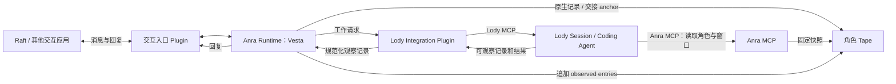

# Plugin Integration Spec

状态：设计草案。本文规定角色如何通过 integration 工作，以及经历如何进入 Tape。
Plugin 注册及调用契约见 [Plugin Spec](plugin-spec.md)，外部执行端读取上下文见
[Anra MCP Spec](anra-mcp-spec.md)。

## 场景与领域关系

Anra 管理角色及其 Peer 身份。支持 Role 的应用可以作为交互入口；由 Anra runtime
执行的会话直接写入该角色的 Tape。应用配置可用于绑定，但读取配置不代表已经接管
运行时；交互入口必须实际将消息送入 Anra 并把回复送回原会话。

Vesta 在 Raft 与用户或其他 agent 交流，决定需要编码时，通过 Lody integration
plugin 发起 Lody session。Lody 保留自己的 coding runtime，通过 Anra MCP 读取
本次交接的角色定义和窗口。角色仍是同一个 Vesta；应用内 Role 及 session 是
她的执行绑定和工作经历。



上图的两个 plugin 分别承担交互入口和外部执行。Anra MCP 是独立的核心服务，
不要求其他 integration 使用与 Lody 相同的协议或工具。

## 绑定与交接

RoleBinding 将 Role 与应用租户、稳定外部身份、PluginConnection 及用途关联。
名称仅用于展示；一个 Role 可以有多个不同应用绑定，每个绑定指向已授权目标。
外部执行引用归所属 plugin 解释，不构成新 Peer。第一版按一个 Role 对应一个
Peer 设计，现有 principal 与 role 字符串需要显式关联，不自动按同名合并 Tape。

一次外部工作由 Tape 上的交接 custom anchor 标识，不另设 Handoff 对象。Anra 在
提交工作之前写入该 anchor；执行引用、提交状态和观察进度属于关联的执行记录，
不写回或修改 anchor。同一外部 session 可以服务多次交接，每次都有自己的 anchor。

## 交接 Custom Anchor

交接记录使用 Tape entry kind `anchor:custom`，其 summary 为以下 JSON 对象。
`schema` 使用 integration 专属的版本化命名空间；不得使用有独立摘要、归档和
rewind 语义的 `anchor:handoff`。

```json
{
  "schema": "anra.dev/anchor/intr/v1",
  "type": "integration.handoff",
  "role": { "id": "vesta", "version": "role-revision-42" },
  "target": { "name": "lody", "bindingId": "vesta-lody" },
  "task": "实现指定功能",
  "context": {
    "view": {
      "source": { "agentId": "vesta", "tapeId": "tape-id" },
      "snapshotHead": "20",
      "scope": { "seqS": "1", "seqE": "20" }
    },
    "projectionVersion": "context-v1"
  },
  "origin": { "name": "raft", "bindingId": "vesta-raft", "sessionId": "session-id", "eventId": "event-id" }
}
```

| 字段 | 约束 |
| --- | --- |
| `schema`, `type` | 必填，分别固定为 `anra.dev/anchor/intr/v1` 和 `integration.handoff`。 |
| `role.id`, `role.version` | 必填，稳定角色标识及可重建的角色定义版本；不能只保存显示名称。 |
| `target.name`, `target.bindingId` | 必填，分别为目标 integration 的稳定名称和已授权的目标 RoleBinding ID；连接和应用目标由绑定解析，名称须与绑定所属 integration 一致。 |
| `task` | 必填，交给外部执行端的任务文本；不得包含凭据。 |
| `context.view` | 必填，固定上下文的 TapeView 引用，含 Tape 身份、快照 head 和半开区间；序号为十进制字符串，语义遵循现有 TapeView 契约。 |
| `context.projectionVersion` | 必填，固定窗口的投影版本，保证读取时可重建同一内容。 |
| `origin` | 可选的来源关联；存在时 `name` 必填，标识来源 integration 的稳定名称；已知时记录 `bindingId`、`sessionId` 和 `eventId`，未知字段省略，不推断来源。若提供 `bindingId`，名称须与其所属 integration 一致。 |

anchor 的身份是其 Tape 身份与 entry sequence 的组合，后续观察、执行状态和结果
显式保存该引用；不是将记录嵌套在 anchor 下，也不靠相邻位置推断关联。相同 anchor
标识同一次交接，重试复用该引用和相同请求；新工作创建新 anchor。引用不是凭据，
读取仍须按 [Anra MCP Spec](anra-mcp-spec.md) 授权。

上述结构是目标契约，尚未实现。现有 `anra.dev/anchor/v1` 解码器会拒绝所有其他
`anra.dev/anchor/` schema；实现时须调整 schema 分派，让 integration anchor 由
对应解码器处理，同时保留对未知版本和格式错误的明确拒绝。

现有 TapeView 的 head 是已完成 turn 的
closing anchor，不能假设运行中的 turn 已有这样的视图。实现前须定义并验证
安全快照、anchor 的持久化顺序与崩溃恢复；如果现有 TapeView 无法表示所需窗口，
必须先明确扩展其契约，不能构造不符合现有语义的引用。未持久化的 anchor 不得用于
发起外部工作。

## 经历写入 Tape

```text
交互应用消息及 Anra 原生执行 entries
→ 交接 anchor
→ 外部工作期间的 observed entries
→ 外部工作结束记录
→ Anra 中的角色继续工作
```

Anra 在外部 session 运行期间追加可观察的消息、状态和结果；不只保存 handoff
请求与最终结果。可见范围受应用能力约束，未暴露的推理和工具事件不可补造。
结束记录标记此次执行终态及观察完整性，并不宣称第三方完整历史已同步。
后续补到的记录仍关联原交接 anchor；执行终态和观察对账完成是独立事实。

每条来源记录至少关联应用及绑定、来源会话、可用事件 ID、交接 anchor（如
适用）和内容生产者。交互输入保留来源应用，Anra 产生的回复和工具事件标记为
Anra 产生；外部观察记录标记为实际应用来源。可信来源来自认证连接和绑定，
不能由模型输入自报。旧 entry 缺少来源时保留 unknown，不推断或伪造。

有稳定来源 ID 时使用绑定、会话和事件 ID 去重；修订通过追加记录保留版本关系。
没有稳定 ID 时明确去重与恢复的限制。Tape 的本地追加顺序不代表跨应用的真实全局
时间顺序。插件产生规范化记录，核心校验关联、写入 Tape 并持久化进度，不将
外部观察冒充当前 ADK turn 的模型或工具事件。避免同时将原始工具响应与展开的
相同内容作为两份经历。

## 执行、恢复与角色继续

Anra 提交工作后，记录 plugin 返回的外部执行引用，并通过 plugin 观察后续进展。
提交成功只表示工作已被接受，执行结果由后续观察获得。提交失败或超时而无法
确定是否已被接受时，应报告不确定结果；没有可靠的去重或查询能力时，不自动
重新提交，以免重复执行。这里不预设统一的提交状态机。

观察进度只在记录持久化后推进；重启后对已知执行做状态与历史对账，不创建替代
执行。idle、连接断开或 presence 消失不能单独证明完成。取消请求与实际结果分别
记录，晚到结果可关联原交接 anchor，但不得重复触发角色继续执行。

每个 Tape 同时只允许一个 reasoning turn。外部执行和授权的快照读取可以
在原 turn 结束后继续；结果先持久化，等待 admission 可用后继续角色工作。
回调不能直接重入 Run。去重、Tape 追加及继续执行的恢复须防止崩溃产生重复；
后台观察追加也不得改变已经固定的上下文窗口。

## Lody 首个闭环

1. 建立 Raft 交互绑定和 Lody 外部执行绑定；Raft 消息由 Anra runtime 执行并写 Tape。
2. Vesta 决定编码，Anra 固定角色版本和窗口，持久化交接 custom anchor。
3. Lody plugin 确认目标及上下文访问能力，调用 Lody MCP 创建或继续 session。
4. Lody coding agent 通过 Anra MCP 读取授权窗口，以自己的 ACP runtime 执行。
5. Plugin 将可观察经历交给核心，核心带来源和 anchor 关联追加 Tape。
6. 取得有效终态证据后记录结束；Vesta 在 Anra 继续工作并通过原入口回复。

Lody MCP 连接与 Anra MCP 连接是两个独立方向，身份和凭据不能混用。当前环境中的
Lody 工具可供会话调用，但尚未证明独立 Anra 进程能获得同样的入口、身份及结果
交付；Lody MCP history 是有界可见记录，完整可重放事件订阅尚待验证。首个接入
必须先验证这些事实；缺少所需能力时报告限制，不声称持续观察已实现。

## 能力、延迟与验收

交互入口、外部执行连接和 Anra MCP 分别检查授权、启用状态与可用能力。只有目标
支持的操作才可使用；连接配置存在不等于目标可以执行或读取上下文。

衡量消息入站、anchor 固定、外部提交回执、首次上下文读取、观察记录到达、终态
及回复延迟，记录 p50/p95 和错误率；标明同机/跨机器部署及样本量。按需分页、
复用连接；跨机器时钟差不直接视为精确耗时。测量结果用于决定是否需要优化。

实现须增加 `tests/e2e/features/*.feature` 场景，通过公开 API、真实 HTTP、临时
磁盘和确定性模型与应用 fixture 验证：

- 交互入口接管 runtime，来源消息和 Anra 执行直接写入正确角色 Tape。
- anchor 在外部提交前持久化，新消息不改变既定窗口，旧 Tape 和 anchor 仍可读。
- 外部执行端通过真实 MCP 读取窗口；权限隔离、分页、撤销和并发按规范生效。
- 工作期间的可观察消息与状态进入 Tape；来源、顺序、修订和观察缺口可追溯。
- 重复交付、断线重连、重启、未知提交、取消和晚到结果不会重复启动或继续执行。
- 两个独立 integration fixture 使用同一核心交接流程，不依赖特定应用字段。

开发运行 `mise run e2e`，交付运行 `mise run test`。真实第三方连通作为 opt-in
验证。以上为目标行为，当前均未实现。
