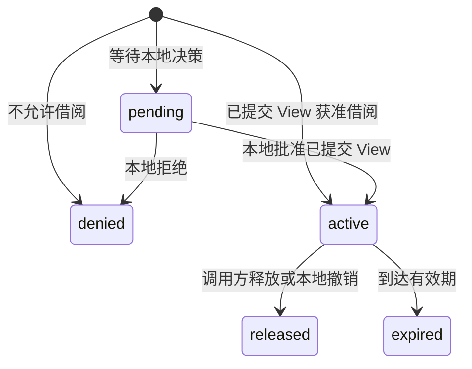
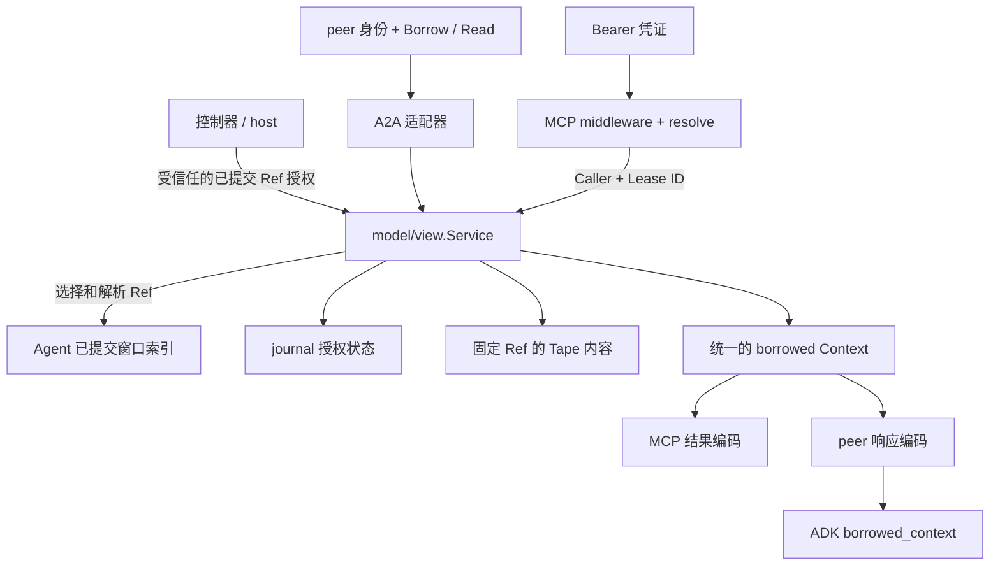

# 共享 View 与借阅服务

状态：架构决议，尚未实现。本文描述目标设计，不表示当前 MCP 已接入 peer lease。

MCP 和 peer 读取同一类已提交上下文，统一使用 `pkg/model/view` 的借阅服务、内容表示和来源信封。peer 也只允许借阅已提交的 View，去掉空范围授权和自由选段能力。

本次允许直接调整类型、协议和存储格式。不设计历史数据迁移、兼容解码、旧字段、过渡别名或双入口回退。

## 现状与问题

- `pkg/mcp/view.go` 自行读取 Tape、生成 `TapeViewResult` / `ViewEntry`，从 MCP Grant 组装 Channel 和 Provenance。
- `pkg/a2a/service.go` 同时承担协议服务、范围选择、lease 签发、读取、分页和撤销。现有 `pb.View` 是授权，`pb.TapeView` 是没有授权的快照引用，两者名称没有表达差异。
- `pkg/agent/tools/borrow.go` 再从 peer decision 和 page 组装另一份 `borrowed_context`。两条路径已经共用 Entry 内容，却没有共用借阅模型。
- `entry.Channel` 和 `entry.Provenance` 描述消费权限，却放在持久化条目包内。

只移动响应结构体不能解决这些问题；共享的业务规则和 lease 状态必须有同一个所有者。

## 领域概念

| 概念 | 内容 | 所有者与约束 |
| --- | --- | --- |
| Ref | Source、SnapshotHead、Scope | 定位一个真实、已提交、不可变的 View，本身不授予读取权限 |
| Lease | ID、Caller、Ref、ExpiresAt | 借阅服务签发；精确绑定一个 Ref 和一个调用方 |
| Context | Channel、Provenance、公开条目 | 借阅服务依据当前有效 lease 构造，供 MCP 和 peer 共同消费 |
| Entry | Seq、Kind、Timestamp、公开内容 | `entry.Entry` 提供多模态内容，anchor 提供公开 Body；读取结果不暴露原始存储条目 |

### 已提交的 View

Ref 统一采用现有 `TapeView` 的语义：

- Source 标识 agent 及其 Tape incarnation。
- SnapshotHead 是持久化成功的关闭锚点；它是固定的提交边界。
- Scope 是非空半开区间 `[SeqS, SeqE)`，且 `SeqE == SnapshotHead`。
- 所有序号均为无前导零的非零 ASCII 十进制字符串，保持任意精度。
- 原生完整 Turn 的 Scope 为 `[start + 1, close)`，排除起止控制锚点。失败、取消和未结束的 Turn 不成为可借阅 View。

格式合法不等于已经提交。原生 Agent 的已提交窗口索引负责解析 Ref，确认 Source、Head 和 Scope 对应同一个真实窗口。借阅服务信任该解析结果，不再次对 Provider 输出进行格式扫描，也不通过当前 Tape head 推导新范围。

peer 的全部借阅路径都经过这个解析入口。按 purpose/query 选择时只能选择一个已提交 View；指定 Ref 时只能解析完全相同的 View。请求中的 bounds 若保留，只能作为资格约束：不能完整容纳该 View 就拒绝，不能据此截取子段。

没有可用窗口返回 denied，需要本地决策时可以返回 pending。只有 granted 决策携带 lease；不再签发空范围 lease，也不允许策略返回任意 Tape 范围。锚点导出的验收数据同样必须先形成真实的已提交窗口。

### 借阅 lease

Lease 精确绑定 `Caller + Ref`，包含公开 ID 和有效期。ID 用于引用授权，不是 Bearer secret。其 Ref 在签发后不变，后续推理、追加数据或新窗口都不改变已有 lease。

状态由现有 journal 持久化：

expired 由有效期判定，不要求额外写一份过期状态。借阅请求以调用方和 request ID 实现幂等；同一请求的重放不延长有效期，改写请求内容产生冲突。释放保持幂等，终止后的 lease 不重新激活。

每次读取按 Caller 和 Lease ID 解析当前授权，检查释放、撤销和到期状态，然后读取固定 Ref。读取不调用 Borrow、不续租、不重新选择 View，也不进入推理 Admission。

共享服务为 Read 的授权判断和 Release / Revoke 的提交定义一致的先后顺序。终止状态先提交的后续读取必须拒绝；已经获得读取许可的在途请求可以完成，撤销不能收回已发送的内容。

### 内容和来源

所有借阅读取统一产生 `view.Context`：`channel: borrowed`、一份 Provenance，以及公开条目。Provenance 包含 Caller、Lease ID、Source、SnapshotHead 和 Scope。删除独立的 MCP Grant ID 来源链；Bearer 凭证只是引用这个 lease。

Channel 和 Provenance 从 `entry` 移到 `view`。它们由已验证的借阅关系产生，不能从条目内容、客户端参数、历史 user/model role 或自述身份中推导。Primary / Observation 仍由原生消费方赋予；两个借阅入口只能输出 Borrowed。

Context 是权限信封，公开 Entry 只携带条目标识和内容，不逐条复制 Channel、Provenance 或整份 Ref。分页属于同一个 Context，不能改变其 lease、来源或范围。

内容继续复用现有领域对象：

- 模型内容使用 `Entry.Content()` 的 SDK-backed 多模态结构，保留 Part 顺序、思考文本及 thought 标记、图片、音频、文件和工具内容。
- 原生锚点调用 `Record.Body()`，排除 OwnerEpoch；第三方锚点保留原文，分享责任由 View 的选择方承担。
- 不导出执行状态、任意扩展或 provider thought signatures；读取公开表示不修改 Tape 中的原始事件。

公开 Entry 存在模型内容、原生锚点和第三方文本三种实际内容形态，不再重新手写 GenAI Part 模型或引入 Projection。异构内容的编码集中在共享出口完成；协议适配不再自行判断条目种类或删改 Parts。

保留不支持内容和编码失败的显式错误，不静默删除条目。统一取消现有 MCP 对空 Parts 的独立过滤，两条协议对同一 View 返回相同条目序列。业务 JSON 中的数字词法必须保持精度，禁止经 `map[string]any` 解码后重新编码。模型工具因 ADK 转换需要而使用 JSON 文本字符串的处理留在工具适配边界。

Channel 是消费权限约定，不能保证任意模型免疫 Prompt 注入。原生消费者将 Context 放入只读 `borrowed_context` 工具结果，历史内容不展开为当前 Session 的主指令；实际工具执行权限仍由运行时控制。

## 模块职责与依赖

`pkg/model/view` 拥有借阅规则和公共模型。根包 `pkg/model` 继续负责 LLM provider 初始化。共享服务从现有 A2A 服务抽取，直接使用现有 Tape 和 journal，不调用本进程的 HTTP 接口，也不增加第二套状态。

| 模块 | 目标职责 |
| --- | --- |
| `agent` | 提交和恢复 Turn，维护已提交窗口索引，解析或选择准确的 Ref |
| `model/view` | 借阅决策、lease 签发和读取、固定快照读取、公开内容、分页、来源信封和领域错误 |
| `model/entry` | 存储条目、扩展访问、SDK-backed 模型内容 |
| `model/anchor` | 原生执行记录及公开 Body |
| `model/journal` | 持久化幂等决策、lease 和终止状态，保证原子写入 |
| `mcp` | Bearer 认证、请求上下文、交接与角色权限、MCP 编解码和公开错误映射 |
| `a2a` | peer 身份、extension 协商、Connect/REST 与 A2A 编解码、领域服务调用和错误映射 |
| `agent/tools` | 发现 peer、发起借阅、完整读取、把共享 Context 转为 ADK 工具结果 |
| host / `peer` | 创建和注入同一个借阅服务，拥有依赖初始化、关闭及凭证发行 |

共享服务只定义已经有调用方的能力：Borrow、Get、Read、Release 和本地 Resolve / Revoke。控制器可通过受信任的本地操作，为准确的已提交 Ref 签发调用方 lease；它与 peer Borrow 使用相同的签发及 journal 写入规则。本地操作不成为新的远程管理接口。

现有 Exporter 有文本和结构化内容两种实际实现，可以保留这个策略边界并迁到共享服务。每个部署为两个协议注入同一个内容策略；MCP 不再有独立的 `exportEntry`。不为测试新增 Provider 框架、通用 middleware 框架或一组仅转发字段的接口。

### 类型与 Protobuf

将 Source、EntryRange、Ref 和 Lease 等公共数据声明从 A2A 命名空间抽到中立的 `proto/anra/model/view/v1/view.proto`，生成到 `gen/anra/model/view/v1`。原 `TapeView` 命名为 Ref，原授权 `View` 命名为 Lease，Lease 直接引用单个完整 Ref，去掉重复的 Source / Head / ranges 字段组。

借阅业务请求和 Decision 同样由公共 schema 声明，供共享服务和 journal 使用，避免 journal.State 继续通过 A2A 请求类型反向耦合协议。RPC 专有的响应封装及 HTTP annotations 继续位于各协议 schema 中。

这些无传输行为的生成消息作为共同的类型化领域值使用；不再另写一套同字段 Go struct，也不加旧名 alias。`pkg/model/view` 拥有消费模型和行为。JSON / ProtoJSON 编码属于边界，统一使用明确的字段名。

Protobuf 的字段约束使用 Protovalidate，非 Protobuf 的构建约束使用 validator 标签。在外部输入或对象构建边界完成格式验证；共享服务执行真实的提交解析、授权和状态转换规则，消费方不递归重复验证受信任结果。

这样 anchor 和 journal 可以依赖公共生成值，而不依赖 `pkg/model/view` 的服务；共享服务可以使用 anchor 公开内容，不形成 `view -> anchor -> view` 的包循环。A2A 的客户端、生成消息和错误类型不会反向进入共享业务服务。

修改 `.proto` 后重新生成，禁止直接编辑 `tape.pb.go`。直接删除旧的重复声明，不保留兼容字段或历史存储读取路径。

## 两个入口的调用链

MCP 的凭证验证结果绑定 Caller、Lease ID、RoleRef、AnchorSeq 和工具权限。凭证本身的有效期、撤销和交接绑定仍由 issuer / GrantVerifier 负责；lease 的有效期、撤销和来源由共享服务负责。不再携带一份可绕过 journal 直接读取的独立 TapeView 授权。

`read_tape_view` 先执行现有交接和工具权限检查，再通过共享服务读取绑定 lease。`read_role` 仍读取绑定的角色 revision；Tape lease 不提供角色权限。若交接承诺了 Ref，控制器签发时必须确保它与绑定 lease 完全相同，不能在读取时重借一个新 View 来代替。

认证失败继续映射为 401 / Bearer challenge，认证后端不可用为 503；工具阶段的失效或不属于当前调用方的 lease 映射为公开 permission_denied，不能暴露其他调用方的授权是否存在。两种协议映射同一组领域错误，不把底层存储诊断返回给客户端。

保留 Origin 先于认证、重复 Authorization 拒绝、请求级身份隔离和所有 MCP 响应 no-store。Bearer 不增加字符集限制，也不进入日志、Tape 或 Provenance。请求和内容响应不增加固定 body 上限；分页按条目划分，不拆分或截断多模态内容。

## 落地顺序与验收

1. 建立公共 Ref / Lease schema 和 `pkg/model/view`，明确上面的约束及字段名，重新生成协议绑定。
2. 将 A2A 借阅业务和现有 journal 接入共享服务；所有借阅改为解析已提交 View，删除自由范围 Policy 和空 lease 分支。原生 anchor、委托提示和 journal 使用公共 Ref / Lease。
3. 将公开条目出口、Channel 和 Provenance 收到共享服务，删除 MCP 与 peer 各自的来源组装及内容分支。
4. MCP 凭证改为绑定同一服务的 lease，删除直接 TapeReader 旁路；host 注入同一个实例。同步更新协议与运行文档。
5. 通过真实 HTTP、Tape 和 journal 完成验收，再提交实现。

复用并调整现有中文 E2E，重点覆盖：

- 同一调用方和 lease 经 MCP、peer 得到相同 Ref、Provenance、条目顺序及完整内容。
- 没有成功提交窗口时拒绝借阅；未结束或失败 Turn、空范围及自由区间不能生成 lease。锚点与大型媒体用例通过真实提交窗口构造。
- Bearer 或 peer 调用方不能读取另一调用方的 lease，参数不能改写 Scope / Head；角色工具权限独立执行。
- 追加新 Turn 和服务重建不扩大已有 Ref；释放、撤销及到期对两个入口同时生效。Read 不签发、不续租、不进入推理。
- 多模态、思考内容、原生和第三方锚点、JSON 数字精度及私有元数据边界在两个入口保持一致。

纯算法与编解码边界才增加单测，不为字段搬运添加 mock 或测试接口。实现完成后运行 `GOFLAGS=-race mise run test`；本次设计文档不修改运行时代码，不以先前测试结果冒充实现验收。
