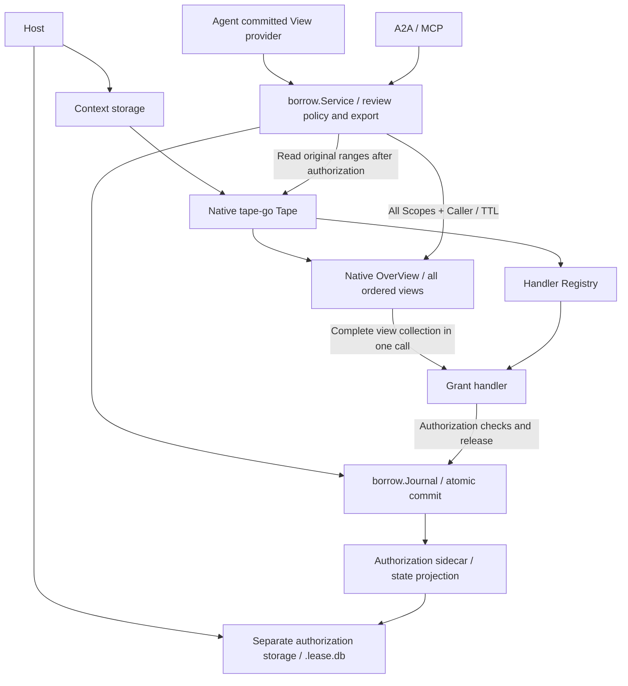

# Tape Handlers over Native Views

The dependency is pinned to `github.com/scbizu/tape-go v0.2.0-anra.5`, using the upstream `Tape`, `view.OverView`, `view.Registry`, and `view.Handler` directly. Anra removes its local `pkg/tape` wrapper and retains only the borrowing domain's handler and sidecar. The native Tape continues to manage context through the same storage interface. Crops illustrates another possible View behavior; this design does not implement a general crops journal.

## Domain Relationships and Interfaces

| Concept | Responsibilities and invariants |
| --- | --- |
| Tape | Native upstream type that holds context, storage, read/write windows, and the Registry |
| Registry | Registers and looks up capabilities by `Handler.Action()`; its zero value is usable, it is concurrency-safe, and it rejects duplicate actions and replacement |
| OverView | Binds a native ordered collection of EntryViews to a Registry; one Handle call dispatches all views |
| Grant handler | Issues candidate leases from native views, checks committed lease validity, and delegates release |
| Borrow Journal | Owns request idempotency, pending decisions, atomic commits of requests and leases, release records, and recovery |
| Sidecar | Separate storage for auxiliary authorization records; it contributes no context and is not a second Tape |

`Tape.OverView(ctx, scopes...)` loads all EntryViews in the supplied order through native Range operations and associates them with Tape.Registry. `OverView.Handle(ctx, action, payload)` passes the original context, the complete `[]*EntryView`, and the payload to the registered handler in one call. Registry construction, duplicate-action checks, and dispatch are all implemented upstream. Binding alone neither proves that a View is committed nor grants read access.

`borrow.Service` validates the committed Ref's Source, scope ordering, and physical bounds. It passes every Scope to the same native OverView and checks the returned view count, owner, session, and individual ranges. `grant.Service` derives the complete Ref from the views it actually receives, rejecting views that span owners or sessions, empty views, overlapping ranges, and invalid ordering before issuing one candidate lease. `grant.Request` carries only Caller and TTL. Gaps between scopes are neither read nor authorized.

The host first binds initialized sidecar storage through `borrow.NewJournal`, creates `grant.New(grant.Config{Leases: journal, ...})`, registers it in the native Registry, and then assembles the borrowing service with `borrow.New`. The borrowing service checks consistency across Source, Owner, the Registry handler, and the Journal. A candidate lease permits reads and can be released only after it is committed to the Journal together with its request decision. Calling the handler directly does not create an effective authorization. See [flow boundaries](flow-boundaries-design.md) for the complete responsibility split.

## Authorization Flow

A request first looks up its recorded decision by Caller + Request ID and replays it if found. New requests invoke `borrow.Config.Review`. When authorization is required, the service resolves a committed View, obtains a complete candidate lease through a multi-scope OverView.Handle call, and asks the Journal to append the request and granted decision in one operation.

Pending and denied are request outcomes; they do not fabricate authorized Views. `Approve` approves only an existing pending request without rerunning Review. If no eligible View can be selected, it leaves the request pending and returns an unavailable error. `Reject` explicitly denies a pending request. Both operations return a conflict for completed requests. Borrow owns the request state machine, while grant determines validity from the clock without appending separate expiration records. Release is idempotent, and terminated leases cannot be reactivated.

Multiple borrowing services, A2A, and MCP share one Journal and grant service. The Journal lock covers state refresh, comparison with the expected snapshot, lifecycle checks, and record append, so competing approvals can commit only once. Read authorization and release are ordered at the same commit boundary: reads authorized after termination commits fail, while reads already authorized may finish.

## Reading through io.Reader

The domain API is `Read(ctx, caller, leaseID) (io.Reader, error)`. It authorizes the current lease and opens a lazy JSON Quote stream. The authenticated Caller is separate from the lease ID. Opening the stream performs no context-content reads. The caller chooses its byte buffer and consumption pace, keeps the context alive while reading, and finishes consumption before the host closes storage.

Each complete authorized scope gets a request-local native Tape configured with SetView. io.MultiReader joins those readers in scope order. A synchronous entry exporter consumes native JSONL records and emits public Quote entries one at a time, preserving opaque payload numbers and filtering private extensions. The shared host Tape's read position is never modified or closed. The stream owns no goroutines, files, pagination state, or continuation tokens.

The upstream reader uses a background context and skips missing entries. A private storage adapter binds the request context and requires each entry to exist with the expected sequence and owner. Storage EOF is a failure; only exhaustion of the configured scopes ends the source normally. A source failure is terminal and never emits the Quote's closing array/object. A later call to a failed reader returns the same error. Cancellation stops further consumption.

`view.Decode` consumes exactly one complete Quote and checks for trailing source errors or values. Connect/REST Read retains its unary RPC and materializes that Quote before responding; MCP uses the same decoder. They return an error without a partial Quote when any authorized entry is missing, unreadable, or unsupported. Direct Go callers can consume the Reader incrementally. Reads already authorized may finish after a later release, while opening another reader rechecks the lease.

ReadRequest carries only lease_id and ReadResponse carries one complete Quote. Removed pagination field numbers and names are reserved. The client validates exact provenance and sequence coverage of every granted scope, and BorrowContext returns a decision and one Quote. Collaboration progress is recorded only after this complete validated read. No default truncation, page size, cursor, or maximum-page capability is part of the current reading model.

## Sidecar and Resource Ownership

The host selects and initializes separate sidecar storage. Bbolt may use `<agent>.lease.db`; JSONL uses a separate directory. The sidecar inside the Journal only adapts storage Get, Range, and Store operations. It does not construct `te.Tape`, initialize or close storage, or expose context Views. Its internal use of entry.Seq addresses sidecar records only; these positions are neither context coordinates nor the sequence of another context Tape.

Every `anra:lease-decision/v1` record stores Caller, the ProtoJSON Request and Decision, and Released. Records start at sequence 1; opening or reopening an empty Journal writes nothing. The host supplies the stable Source, with no separate binding record. Each append serves as both the source of the new state and its audit record. There is no generic Crop envelope, separate authorization table, or duplicate audit store. Recovery validates the complete new record sequence, lease Source, caller, lease ID uniqueness, and legal transitions before publishing the in-memory projection. Corrupt, missing, or unrecognized records return errors.

One shared Journal exclusively accesses each sidecar storage instance. Do not create multiple independent Journals over the same storage instance or allow external writers to bypass the Journal. The host stops requests before closing sidecar and context storage. Tape.Close retains the native context storage's close behavior. borrow.Service, Journal, and grant.Service have no Close methods.

The new format neither reads nor migrates historical `.grants.db` files, the previously replaced `.crops.db` files, or sidecars with the removed binding header. Existing leases in those formats must be requested again; context data remains unchanged.

## Validation

Chinese E2E scenarios exercise real HTTP borrowing and persistent storage. They cover empty Journal recovery without writes, grant and release recovery with both sidecar backends, context isolation, missing handlers and duplicate registration, cancellation without an append, and deterministic concurrent decisions across services sharing a Journal. Native multi-scope dispatch persists one authorization record containing every range.

Read acceptance covers complete large multimodal Quotes over Connect, REST, direct clients and MCP; byte-for-byte media and number precision; native and unknown-anchor privacy; unchanged scopes after append/restart; source reads exactly once in authorized order; lazy opening and cancellation; and missing disk records failing both the stream decoder and the RPC without a partial Quote. Pure tests cover entry-stream framing with small reads, terminal source errors and complete-Quote decoding. `BenchmarkBorrowRead` measures full stream consumption and the complete Connect path over real storage. General Registry and OverView tests remain upstream.

The complete migration passed `mise run test`: 255 scenarios and 1,232 steps, including race-enabled E2E. The large multimodal journey completed in 8.52 seconds under its unchanged 20-second deadline. Related packages passed go vet, gofumpt and diff whitespace checks.
