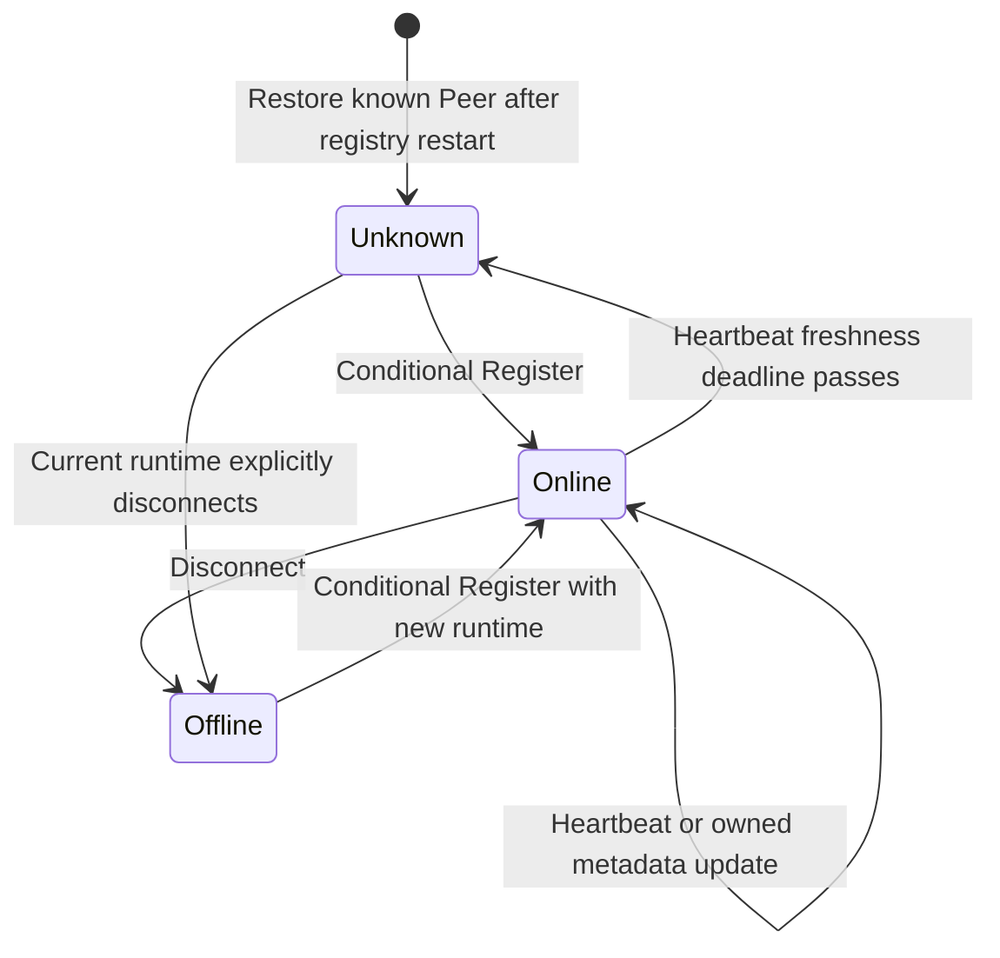

# Registry design

Status: implemented. The registry persists Peer metadata and runtime ownership
in bbolt, observes presence independently, and exposes the generated Connect
API. The former Agent Card-based `/agents` REST contract has been removed.
Registry and clients must be upgraded together.

## Purpose

The registry is a persistent directory of identified Peers, with runtime
presence tracked separately. A Peer represents a particular agent with its own
personality, skills and conversation history. A restart or move to another node
preserves that identity; another agent with a similar skill remains a different
participant.

A caller looks up a Peer, examines its observed presence, then communicates
with that Peer directly. Selecting a different agent is an explicit delegation
decision. The registry owns Peer metadata, runtime ownership and presence; each
agent owns its runtime, conversation, storage and execution admission.

Anra owns the Peer model. A2A Agent Cards are representations produced by an
adapter from that model. CLI, web hosts and peer tools share the same registry
contract. Protobuf RPC interfaces remain protocol implementation details.

## Peer and skill

The canonical metadata consists of a Peer and its skills:

```protobuf
// Shared schema: anra.peer.v1.
message Peer {
  string id = 1;
  string description = 2;
  string address = 3;
  repeated Skill skill = 4;
}

message Skill {
  string id = 1;
  string name = 2;
  string description = 3;
}
```

The field names are `address` and `skill`. There is one Peer model shared by the
registry and its clients. Generated messages provide its wire representation;
implementations should use them directly rather than maintain parallel metadata
structures for every transport.

| Field | Meaning and rules |
| --- | --- |
| `Peer.id` | Stable agent identity. Retain the existing name syntax: start with an ASCII letter or digit, followed by letters, digits, `.`, `_` or `-`. |
| `Peer.description` | Human-readable description. It carries no credentials, private instructions or conversation history. |
| `Peer.address` | Last announced public HTTP(S) origin, including any bound port. Protocol adapters derive paths from this address; presence determines whether it is eligible for a new call. |
| `Peer.skill` | Explicit descriptions of what the peer can do. Skill IDs are unique within a Peer. |
| `Skill.id` | Stable identifier used by callers and adapters to recognize a skill. |
| `Skill.name` | Human-readable skill name. |
| `Skill.description` | Meaning of the skill, suitable for discovery results and Agent Cards. |

Peer and skill IDs must be nonempty, and skill names must contain non-whitespace
text. Registration validates the full snapshot before mutating directory state.
The registry preserves metadata until it is updated by its current runtime or
explicitly removed through `Forget`.
Retain the current 1 MiB registration size ceiling through explicit Connect
message limits.

An initial built-in vocabulary can describe `chat` and `borrow-context`.
`chat` means the peer accepts a question for its reasoning runtime.
`borrow-context` means it supports requesting a permitted context projection.
Advertising that skill grants no access: the lender still decides each borrow
request and enforces requester-bound grants.

The runtime assembles its skill list from the behavior it actually exposes.
Adapters recognize skill IDs through explicit mappings. A free-text skill name
does not create an RPC route or enable a tool. Agent-specific skills can describe
work such as research without adding transport routes.

### Address contract

`address` is an absolute HTTP(S) origin, for example `http://127.0.0.1:8080` or
`https://alice.team.example`. Normalize a trailing slash. Reject user information,
query strings, fragments, non-root paths and a zero port. A wildcard bind address
such as `0.0.0.0` or `[::]` must be resolved to an address clients can use before
registration.

The configured listen endpoint and the registered address have different jobs.
Binding `127.0.0.1:0` selects a concrete port; the Peer records the resulting
address. A deployment behind a proxy supplies its public address. The initial
contract uses root-mounted protocol routes, matching the current peer layout.

All advertised protocol endpoints derive from this address, so the registry can
validate it once. Registry membership does not prove that a remote host is
reachable or that the caller may access its tape. Preserve the last announced
address when presence becomes unknown or offline, and expose it as historical
metadata. Callers use presence alongside the address before attempting a new
request.

## References from established discovery systems

Registration, health and endpoint distribution have different lifecycles in
existing discovery infrastructure:

| System | Mechanism | Meaning for Anra |
| --- | --- | --- |
| Consul | Registration and health checks are separate. A missed TTL update makes a check critical; automatic deregistration is a separate policy. | Reference for retaining known Peers while observing their runtime presence independently. See [TTL checks and deregistration](https://developer.hashicorp.com/consul/api-docs/agent/check#register-check) and [health queries](https://developer.hashicorp.com/consul/api-docs/health). |
| etcd | Keepalive refreshes a lease; expiry or revocation deletes attached keys. | Reference for expiring transient presence information. Attaching the durable Peer record to an expiring lease would violate the retention contract here. See [etcd leases](https://etcd.io/docs/v3.6/dev-guide/interacting_v3/#grant-leases). |
| xDS | A management server distributes versioned configuration and endpoint resources. Envoy normally retains its last configuration during an outage; resource TTLs can bound retention. | Reference for distributing updates if needed later. The current design resolves a specific agent, with explicit selection of any alternative. See [xDS subscriptions](https://www.envoyproxy.io/docs/envoy/latest/api-docs/xds_protocol) and [resource TTLs](https://www.envoyproxy.io/docs/envoy/latest/api-docs/xds_protocol#ttl). |

The design follows Consul's separation of registration and health, expressed in
Anra's Peer model. It uses heartbeats to observe presence and explicit removal
to retire a Peer. Connect carries the registry API. Choosing Consul, etcd or
another infrastructure backend would be a separate implementation decision.

Runtime uniqueness and registry reliability have separate responsibilities.
The registry allows one current runtime owner per Peer. Restoring Alice on
another node requires her identity and durable state; routing to Bob changes the
agent doing the work. Registry persistence preserves the directory across a
restart without replicating the agents themselves.

## Presence and runtime ownership

Operational information is returned alongside the Peer:

```text
Presence
  runtime_id        identifies the current runtime, when known
  last_seen         registry time of its last accepted contact, when known
  state             ONLINE, OFFLINE or UNKNOWN
```

`Peer` remains the canonical metadata model using `address` and `skill`.
Presence is registry-owned observation data. Lookup and list return both, with
an opaque record revision for conditional registration changes. They never
return runtime ownership credentials.

| State | Meaning | Behavior for a new call |
| --- | --- | --- |
| `ONLINE` | The registry accepted registration or a heartbeat within its freshness window. | The address is eligible for a call; connection and request failures remain possible. |
| `OFFLINE` | The current runtime explicitly disconnected. | Report that this Peer is offline. |
| `UNKNOWN` | Contact became stale, or the registry restarted and has not re-established presence. | Report uncertain availability and wait for fresh registration. |

`PRESENCE_STATE_UNKNOWN` is also the default enum value; the generated enum
constants have the `PRESENCE_STATE_` prefix. A fresh heartbeat observes contact
with the registry; it does not guarantee reachability from every caller or prove
that reasoning will succeed. BUSY remains an invocation outcome. It leaves
presence online while the runtime continues heartbeating.

### Ownership invariants

Each process start generates a fresh `runtime_id` and private ownership token.
The ID identifies an execution of the same Peer, and the token authorizes its
registry mutations. The registry stores the current ownership binding and whether
its lifecycle is closed separately from public Peer metadata, and checks these
rules atomically:

1. Each Peer ID identifies one durable Peer record. Only explicit `Forget`
   removes it from lookup and list.
2. Each Peer has at most one current runtime owner. A different runtime cannot
   replace an online owner. Replacement of an unknown or offline owner requires
   an explicit conditional registration against the current record revision.
3. Only the current runtime and its matching token may heartbeat, update metadata
   or disconnect. A replaced runtime's messages are rejected even if the newer
   runtime later becomes unknown or offline.
4. Registering a new runtime or changing metadata compares the expected revision
   and commits a new revision. Conflicting writes cannot silently overwrite each
   other. An identical retry against the resulting current snapshot is an
   idempotent success; an older request cannot roll back a later change.
5. An address, description or skill change is a validated metadata update by the
   current owner through `Register`. It preserves Peer identity and requires no
   removal of the Peer.
6. Heartbeat freshness is measured by the registry's clock. At the freshness
   deadline, online presence becomes unknown. Peer metadata remains unchanged.
7. Heartbeats from unknown or disconnected runtimes do not reopen ownership.
   An unknown runtime must re-establish presence through conditional `Register`;
   a disconnected process starts a new runtime before reconnecting.
8. A stale request cannot recreate a forgotten Peer. Explicit retirement retains
   a minimal persistent tombstone so retries from prior runtimes are rejected.
   Reuse of a retired ID requires a separately designed administrative action.

`Register` must apply the metadata and ownership change as one transaction.
`expected_revision` is empty for creation; otherwise it carries the opaque
revision from Lookup or Register. Revisions include a registry-run epoch and a
persistent per-Peer version. A request fingerprint recognizes an identical
current registration retry. Replaced runtime IDs remain fenced in the ownership
record, and tombstones preserve explicit retirement. Ownership checks fence registry mutations. Exclusive
agent execution still depends on runtime and tape ownership: a process can keep
running during a network partition after its presence becomes unknown.

### Presence transitions



The diagram describes a known Peer. Initial registration creates the durable
Peer and online presence together. `Forget` is explicit retirement, separate
from these presence transitions.

The trusted-network deployment model remains in effect. Ownership tokens protect
registry mutations; peer identity headers and TapeView authorization keep their
separate responsibilities. Discovery grants no permission to read context.

## Connect RPC contract

The registry API under `anra.registry.v1` imports the shared `anra.peer.v1`
schema:

```protobuf
service RegistryService {
  rpc Register(RegisterRequest) returns (RegisterResponse);
  rpc Heartbeat(HeartbeatRequest) returns (HeartbeatResponse);
  rpc Disconnect(DisconnectRequest) returns (DisconnectResponse);
  rpc Lookup(LookupRequest) returns (LookupResponse);
  rpc List(ListRequest) returns (ListResponse);
  rpc Forget(ForgetRequest) returns (ForgetResponse);
}
```

The full request/response messages and validation annotations live in
[`registry.proto`](../proto/anra/registry/v1/registry.proto); canonical metadata
lives in [`peer.proto`](../proto/anra/peer/v1/peer.proto). Generated `Entry`
responses contain Peer, Presence and revision. This document uses readable state
names; ProtoJSON uses `PRESENCE_STATE_ONLINE`, `PRESENCE_STATE_OFFLINE` and
`PRESENCE_STATE_UNKNOWN`.

| Operation | Input | Result and behavior |
| --- | --- | --- |
| `Register` | Peer, runtime ID, private token and expected record revision | Create a Peer, refresh current runtime metadata/presence, or conditionally replace an unknown/offline runtime. Return Peer, presence, revision and heartbeat policy after the durable change commits. |
| `Heartbeat` | Peer ID, runtime ID and token | Refresh contact for the current online runtime and return its current Entry and heartbeat timeout. Metadata and ownership are unchanged. |
| `Disconnect` | Peer ID, runtime ID and token | Mark the current runtime offline and close its presence lifecycle. Preserve the Peer and address. An identical retry succeeds; a superseded runtime is rejected. |
| `Lookup` | Peer ID | Return Peer, observed presence and revision for a known Peer in any state. Never-registered or forgotten IDs return `not_found`. |
| `List` | Optional presence-state and skill-ID filters | Return known Peers with presence and revision in Peer ID order. Without filters, include online, offline and unknown Peers. Filters are combined with AND; the initial team directory returns a complete snapshot. |
| `Forget` | Peer ID and expected revision, invoked explicitly by the operator | Retire an offline or unknown Peer and invalidate its runtime credentials. Preserve a minimal tombstone. Reject removal while online; an identical retirement retry succeeds. |

Use generated Connect clients for these operations. `pkg/discovery` provides
lookup, listing and presence maintenance. Internal callers consume typed Peer
and Presence values. Their protocol clients construct transport from
`peer.address` after checking presence. They do not parse Agent Card extension
maps to find Anra peers.

Presence can change immediately after a response. Clients handle connection and
request failures normally. They do not automatically replay reasoning or route
a request for Alice to another agent. A skill-filtered list returns distinct
Peers for an explicit delegation decision, including when several share a skill.

### Errors

| Connect code | Meaning | Client response |
| --- | --- | --- |
| `invalid_argument` | Invalid Peer metadata, runtime ID, token or filter | Correct the request; stop the invalid registration lifecycle. |
| `already_exists` | Another runtime currently owns online presence | Fail conflicting startup; retain the existing owner. |
| `permission_denied` | A mutation supplied incorrect or superseded runtime credentials | Stop the stale runtime's presence lifecycle. |
| `aborted` | A conditional metadata/ownership change used a stale revision | Read the current record and reassess ownership before an explicit retry. |
| `failed_precondition` | Heartbeat requires re-registration, a runtime already disconnected, an ID was retired, or Forget targeted an online Peer | Re-establish permitted presence through Register, or report the rejected action. A retired runtime must not automatically recreate its Peer. |
| `not_found` | A Peer was never registered or has been forgotten | Report missing identity. Heartbeat and Disconnect do not create a Peer. |
| `unavailable` | Temporary registry or persistence failure | Retry presence maintenance while its parent lifecycle remains active. |
| `canceled` / `deadline_exceeded` | The operation's context ended | Honor cancellation; retry only while the parent lifecycle remains active. |

An offline or unknown Peer is a successful lookup with an explicit presence
state. Timeout does not convert it into `not_found`. Retry decisions must
recognize an identical successful Register or Disconnect whose reply was lost.

## Persistence and restart

The directory uses a durable local bbolt store. The
store persists Peer metadata, record revisions, runtime ownership bindings,
closed-runtime state and retirement tombstones. Acknowledge Register, Disconnect
and Forget only after their durable transaction commits. Keep credentials private
in storage and responses.

Presence observations can be held in memory. On every registry restart, restore
known Peers with unknown presence and invalidate conditional writes from the
previous registry run through a new observation generation in the revision.
`last_seen` may be absent until contact is re-established; the registry must not
invent a recent timestamp. The last announced Peer address and skills survive.

Existing runtime ownership remains known after restart. An unclosed runtime reads
the current revision and re-establishes presence through Register with its current
credentials. A previously disconnected runtime stays closed even though observed
presence resets to unknown. New runtimes can conditionally claim unknown
presence. Whichever claim succeeds becomes the current owner; the other must
honor the result.

The initial deployment has one registry process and one durable store. Replicating
the registry requires a separate consistency design. It does not require
replicating any agent. Registry storage contains no conversation, model state or
raw tape entries.

## Peer lifecycle

The host binds its listener, builds its Peer with the actual address and skill
snapshot, and creates a runtime ID and ownership token. It reads any existing
record, then conditionally registers. Report readiness after registration commits
and HTTP serving starts. Failed startup closes its resources and disconnects its
own established presence, preserving any committed Peer metadata.

Reuse the current 15-second default as a heartbeat freshness window, configurable
with a minimum of one second. Clients heartbeat every third of the returned
window. This policy bounds the registry's confidence in contact; it does not
expire or remove Peer metadata.

Transient failures leave the agent runtime running while discovery retries.
If a heartbeat finds presence unknown, read the current record and conditionally
re-establish presence with the runtime's credentials. If another runtime has
claimed the Peer, stop the old serving lifecycle with that rejection as its
cause. A registry restart follows the same recovery path. Retirement or identity
removal stops automatic presence maintenance.

On graceful shutdown, cancel serving and heartbeat maintenance, then attempt a
bounded Disconnect with a fresh cleanup context. Wait for the lifecycle to
finish and drain reasoning before closing the tape. If Disconnect cannot reach
the registry, presence eventually becomes unknown. Successful Disconnect marks
it offline. In both cases lookup and list retain the Peer until explicit Forget.

## A2A translation

`pkg/a2a` converts a Peer snapshot into an Agent Card. Use the same committed
snapshot for internal registration and the card published by the running Peer.
`Node.UpdatePeer` refreshes the published representation after an accepted
metadata update. If its acknowledgement is lost, subsequent heartbeats reconcile
the committed Entry and refresh the card. Presence recovery uses the registry's
current metadata, so an older local snapshot cannot roll back that commit.
Presence remains separate registry information; a card generated from a stored
Peer does not establish that its address is currently usable.

| Peer model | A2A representation |
| --- | --- |
| `id` | Agent Card name, retaining current identity behavior |
| `description` | Agent Card description |
| `address` | Origin used to construct the messaging interface and extension addresses |
| `skill` | Agent Card skills with explicit IDs, names and descriptions |
| Recognized `borrow-context` skill | TapeView extension declaration for the implemented borrowing contract |

The adapter owns A2A-specific fields, transport names, fixed route paths and
extension versions. Its mapping must preserve the current collaboration and
committed TapeView borrowing contracts. Skill metadata alone cannot infer protocol
version support; adapter code declares the versions it implements.

An internal registration sends the Peer directly. When registering with an
external directory that accepts Agent Cards, the boundary adapter translates the
Peer for that request. The canonical model remains unchanged. Published cards
are generated representations, so they cannot drift through independent edits.

Core A2A messaging continues to use the official SDK. TapeView continues to use
its generated Connect interface. Connect derives RPC paths from Protobuf service
and method names; adapters combine those paths with the Peer address. See
[Connect routing](https://connectrpc.com/docs/go/routing/) and the current
[A2A adapter](a2a-adapter.md).

RPC reflection may expose the registry and TapeView schemas for debugging tools.
It describes an already located RPC endpoint. Peer lookup, skills, runtime
ownership and presence remain registry responsibilities. Reflection is optional
for normal generated clients; see
[Connect gRPC compatibility](https://connectrpc.com/docs/go/grpc-compatibility/).

## Package ownership

| Location | Responsibility |
| --- | --- |
| `proto/anra/peer/v1` and generated bindings | Shared Peer and Skill definitions, field validation |
| `proto/anra/registry/v1` and generated bindings | Registry RPC requests, responses and observed presence |
| `pkg/registry` | Durable Peer directory, runtime ownership, presence transitions, retirement and Connect handlers |
| `pkg/discovery` | Typed registry client, lookup, filtered listing, heartbeats and presence recovery |
| `pkg/peer` | Runtime composition; construct the Peer snapshot; coordinate serving and registration |
| `pkg/a2a` | Translate Peer metadata into Agent Cards and adapt protocol calls |
| `cmd/anra` | Flags, signals and terminal output |

Registry rules live in its domain implementation and are invoked by the Connect
handler. The registry imports the shared Peer schema and has no dependency on
the discovery client, runtime composition package or A2A SDK. The shared schema
has no dependency on those packages either.

## Migration and acceptance

This is a coordinated registry/client migration. The shared Peer/Skill and
registry schemas have generated messages and Connect bindings. `pkg/registry`
owns durable transitions independently of HTTP decoding, `pkg/discovery` owns
presence maintenance, and `pkg/a2a` translates canonical metadata into cards.

The previous registry held only live records in memory, so upgrade cannot recover
Peers that disappeared before persistence was introduced. Running Peers populate
the new directory on registration. Registry restart, shutdown and lost contact
subsequently preserve their records. The directory database is
`<registry-data-dir>/registry.db`, separate from agent tapes.

Start it with `anra registry --data-dir .anra --heartbeat-timeout 15s`.
The former `--lease-ttl` flag is removed. Explicit operator retirement is
`anra registry forget alice --address http://127.0.0.1:9090`; it rejects online
Peers. A retired ID remains tombstoned across restart.

Hosts can use `registry.Open(Config)` with `registry.NewHandler(store)`
(returning a handler and any route configuration error), or
`registry.Serve(ctx, listener, config, ready)` to own serving and storage together.
Discovery clients use `Start` for a runtime session, `Registration.Update` for
owned metadata updates, and `Registration.Close` to disconnect. The optional
Start callback receives metadata reconciled after uncertain update responses;
it runs synchronously and must not call back into the session. Generated RPC
methods remain available for explicit conditional operations.

The registry also exposes Vanguard REST routes under `/v1/registry/`, using the
same implementations and validation as Connect. See [HTTP routes](http.md) for
the protobuf JSON bodies, query parameters, and error format.

The migration targets a small trusted team and upgrades registry and clients
together. It provides one persistent directory and one current runtime per Peer,
with explicit delegation between distinct Peers. Watch streams, replica routing,
address prefixes and administrative recreation of retired IDs remain outside
this contract. RPC reflection remains optional and is not mounted by default.

The executable BDD scenarios under `tests/e2e/` cover:

- Register, resolve and list exact Peer addresses and skills through generated
  clients and real Connect HTTP transport.
- Reject invalid metadata before changing persistent records or presence.
- Preserve identity and metadata while heartbeats time out to unknown, then
  restore online presence when the same runtime registers again.
- Disconnect to offline while retaining lookup/list results and the last address.
- Persist known Peers across registry restarts, restore presence as unknown,
  and re-establish contact without losing metadata.
- Return `not_found` only for absent or forgotten identities. List every known
  Peer by default and apply state/skill filters explicitly.
- Reject competing online runtimes; allow conditional recovery on a new address
  after shutdown or stale contact while preserving the same Peer identity.
- Reject stale revisions, old runtime credentials and delayed updates after
  replacement, including when the replacement later becomes unknown or offline.
- Accept identical retries after lost Register, Disconnect and Forget replies
  without reverting a later metadata change or recreating a retired Peer.
- Update metadata through the current owner without removing identity, and
  refresh the A2A representation from the accepted snapshot.
- Keep heartbeats working while reasoning returns BUSY. A same-skill Peer is
  never an automatic substitute for the requested identity.
- Forget only through explicit retirement, preserve tombstones across restart,
  and reject stale attempts to recreate that identity.
- Preserve A2A messaging, permissioned TapeView borrowing, CLI/embedded-host
  interoperability and cleanup after startup failure.
- Return the documented Connect codes and keep ownership tokens private.

Use deterministic model responses, real temporary disk storage for the directory
and agent runtimes, and a controlled registry clock for presence transitions.
Run `mise run e2e` while developing and `mise run test` for schema, generation,
build and acceptance checks. See [registry scenarios](../tests/e2e/features/registry.feature),
[process discovery scenarios](../tests/e2e/features/discovery.feature) and
[embedding scenarios](../tests/e2e/features/application.feature).
