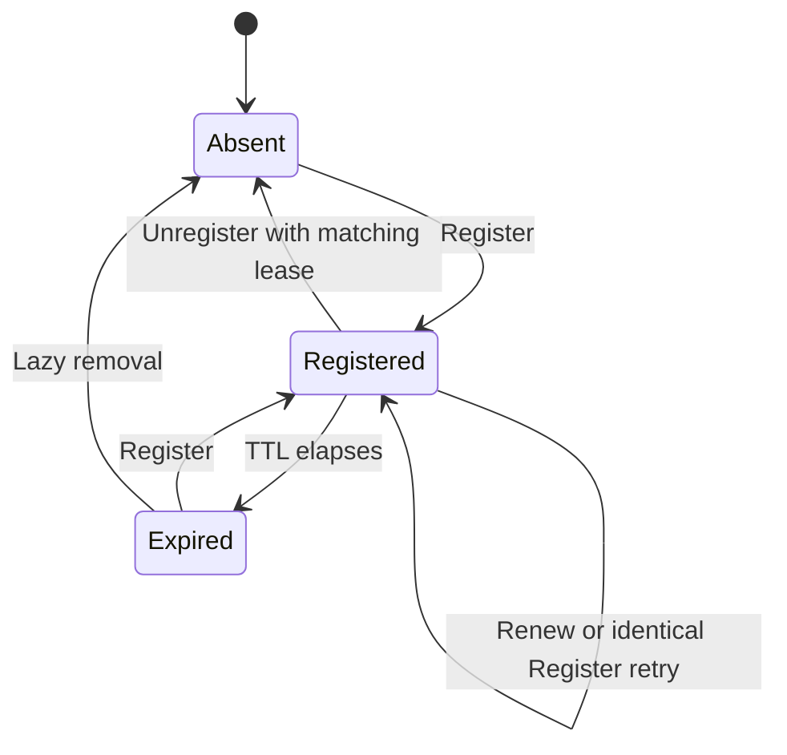

# Registry design

Status: proposed. This document defines the next registry contract. The current
implementation stores `discovery.Record` values containing A2A Agent Cards and
exposes the `/agents` HTTP API. The design below requires an implementation and
acceptance scenarios before it replaces that contract.

## Purpose

The registry lets a participant find another running agent by identity and learn
its address and skills. A caller resolves a Peer, then communicates directly
with it. The registry owns registration and lease state; each agent owns its
runtime, conversation, storage and execution admission.

This is service discovery applied to agent peers. The discoverable domain
concept is **Peer**. Protobuf RPC interfaces remain protocol implementation
details.

Anra owns the Peer model. A2A Agent Cards are a representation produced by an
adapter from that model. CLI, web hosts and peer tools share the same registry
contract.

## Peer and skill

The canonical metadata consists of a Peer and its skills:

```protobuf
// Proposed shared schema: anra.peer.v1.
message Peer {
  string id = 1;
  string description = 2;
  string address = 3;
  repeated Skill skill = 4;
}

message Skill {
  string id = 1;
  string name = 2;
  string description = 3;
}
```

The field names are `address` and `skill`. There is one Peer model shared by the
registry and its clients. Generated messages provide its wire representation;
implementations should use them directly rather than maintain parallel metadata
structures for every transport.

| Field | Meaning and rules |
| --- | --- |
| `Peer.id` | Stable agent identity. Retain the existing name syntax: start with an ASCII letter or digit, followed by letters, digits, `.`, `_` or `-`. |
| `Peer.description` | Human-readable description. It carries no credentials, private instructions or conversation history. |
| `Peer.address` | Public HTTP(S) origin of the running peer, including any bound port. Protocol adapters derive their paths from this address. |
| `Peer.skill` | Explicit descriptions of what the peer can do. Skill IDs are unique within a Peer. |
| `Skill.id` | Stable identifier used by callers and adapters to recognize a skill. |
| `Skill.name` | Human-readable skill name. |
| `Skill.description` | Meaning of the skill, suitable for discovery results and Agent Cards. |

Peer and skill IDs must be nonempty, and skill names must contain non-whitespace
text. Registration validates the full snapshot before mutating directory state.
Retain the current 1 MiB registration size ceiling through explicit Connect
message limits.

An initial built-in vocabulary can describe `chat` and `borrow-context`.
`chat` means the peer accepts a question for its reasoning runtime.
`borrow-context` means it supports requesting a permitted context projection.
Advertising that skill grants no access: the lender still decides each borrow
request and enforces requester-bound grants.

The runtime assembles its skill list from the behavior it actually exposes.
Adapters recognize skill IDs through explicit mappings. A free-text skill name
does not create an RPC route or enable a tool. Agent-specific skills can describe
work such as research without adding transport routes.

### Address contract

`address` is an absolute HTTP(S) origin, for example `http://127.0.0.1:8080` or
`https://alice.team.example`. Normalize a trailing slash. Reject user information,
query strings, fragments, non-root paths and a zero port. A wildcard bind address
such as `0.0.0.0` or `[::]` must be resolved to an address clients can use before
registration.

The configured listen endpoint and the registered address have different jobs.
Binding `127.0.0.1:0` selects a concrete port; the Peer records the resulting
address. A deployment behind a proxy supplies its public address. The initial
contract uses root-mounted protocol routes, matching the current peer layout.

All advertised protocol endpoints derive from this address, so the registry can
validate it once. Registry membership does not prove that a remote host is
reachable or that the caller may access its tape.

## Registration and lease ownership

A registration associates a Peer snapshot with a lease:

```text
Registration
  peer
  lease             private ownership token
  expires_at        assigned by the registry
```

Registration state is separate from Peer metadata. Lookup and list return the
Peer and its expiry; they never return the lease token. The registering process
generates an opaque lease token so it can retry registration after a lost reply.

The registry enforces these invariants atomically:

1. At most one unexpired registration exists for a Peer ID.
2. Only the matching lease may renew or remove a live registration.
3. Retrying registration with the same lease and identical Peer metadata is
   idempotent and refreshes expiry. Another lease cannot replace a live Peer.
4. Expiry is determined by the registry's clock and TTL. Client timestamps cannot
   extend registration. At `now >= expires_at`, the record is expired.
5. Expired registrations are invisible to lookup and list, even if physical
   removal happens lazily. Their identities can be registered again.
6. A new process uses a new lease. A delayed renewal or unregister from an old
   process cannot modify a newer live registration.
7. The stored Peer is a snapshot. The registry copies metadata at its boundaries
   so callers cannot change it without a registry operation.

Metadata stays fixed for a registration. Changing an address or skill list
requires unregistering and registering a new snapshot. The same live lease with
different metadata is rejected. This keeps retry and update semantics distinct.



The registry provides exclusive discoverability. A partitioned process may still
be running after its registration expires.
Existing tape ownership and agent admission rules continue to protect local
execution. BUSY is a reasoning outcome; it does not remove a Peer or stop renewal.

The existing trusted-network deployment model remains in effect. A lease token
establishes ownership of one registration. Peer identity headers and TapeView
authorization retain their separate responsibilities; registry membership grants
no permission to read another agent's context.

## Connect RPC contract

Define the registry API under `anra.registry.v1`, importing the shared
`anra.peer.v1` schema:

```protobuf
service RegistryService {
  rpc Register(RegisterRequest) returns (RegisterResponse);
  rpc Renew(RenewRequest) returns (RenewResponse);
  rpc Unregister(UnregisterRequest) returns (UnregisterResponse);
  rpc Lookup(LookupRequest) returns (LookupResponse);
  rpc List(ListRequest) returns (ListResponse);
}
```

This sketch specifies operation names; the implementation must define the
messages and validation annotations before generating bindings.

| Operation | Input | Result and behavior |
| --- | --- | --- |
| `Register` | Peer and lease | Validate the full Peer, create the registration or accept an identical retry; return TTL and expiry. |
| `Renew` | Peer ID and lease | Extend a live registration owned by that lease; return TTL and expiry. It does not update metadata or recreate a missing registration. |
| `Unregister` | Peer ID and lease | Remove the matching live registration. An absent or expired record is an idempotent success; a different live lease is rejected. |
| `Lookup` | Peer ID | Return the current Peer and expiry, or `not_found`. |
| `List` | Empty request | Return active Peers and their expiries in Peer ID order. The initial team directory returns a complete snapshot. |

Use generated Connect clients for these operations. `pkg/discovery` exposes
`Lookup(ctx, id)` to resolve a Peer and `List(ctx)` to discover peers. Internal
callers consume typed Peer values directly. Protocol clients construct their
transport using `peer.address`; they do not inspect Agent Card extension maps
to find Anra peers.

### Errors

| Connect code | Meaning | Client response |
| --- | --- | --- |
| `invalid_argument` | Invalid identity, address, skill metadata or empty lease | Correct the request; stop the failing registration lifecycle. |
| `already_exists` | Another live lease owns this Peer ID | Fail startup or stop the registration lifecycle. |
| `permission_denied` | A renewal or removal supplied the wrong live lease | Stop the stale registration lifecycle. |
| `failed_precondition` | The same live lease attempted to register different metadata | Require an explicit unregister and new registration. |
| `not_found` | Lookup or renewal found no live Peer | Lookup reports absence; renewal attempts registration again with its snapshot and lease. |
| `unavailable` | Temporary registry outage | Retry renewal or registration while the serving context remains active. |
| `canceled` / `deadline_exceeded` | The operation's context ended | Honor cancellation; retry only when the parent lifecycle remains active. |

The expiry in a discovery result is a snapshot bound, not a promise that the
Peer will remain available until that instant. A caller handles connection and
request failures normally. A reasoning request is never automatically replayed
because a lookup or address changed.

## Peer lifecycle

The host binds its listener, constructs a Peer with its actual address and skill
snapshot, and registers it. Readiness is reported after registration and HTTP
serving have started. A startup failure releases the listener, registration and
opened resources.

Retain the current TTL policy: the registry defaults to 15 seconds, accepts TTLs
of at least one second, and clients renew every third of the returned TTL. The
registry owns that policy; the Peer does not choose its own expiry.

Transient registry failures leave the agent runtime running while the discovery
lifecycle retries. Its previous registration can expire during an outage. If a
renewal returns `not_found`, the client registers the original snapshot again.
This also recovers after an in-memory registry restart. A conflicting or invalid
registration terminates the serving lifecycle with the rejection as its cause.

On shutdown, the host cancels the serving lifecycle and waits for it to return.
The lifecycle stops renewal and attempts bounded unregister cleanup using a
fresh context. Failed cleanup is eventually covered by lease expiry. The host
then drains the agent runtime before closing its tape.

The directory remains in memory. Peers restore membership by registering again;
the registry stores no model state, messages or conversation history.

## A2A translation

`pkg/a2a` converts a Peer snapshot into an Agent Card. The same snapshot is used
for internal registration and the card published by the running Peer.

| Peer model | A2A representation |
| --- | --- |
| `id` | Agent Card name, retaining current identity behavior |
| `description` | Agent Card description |
| `address` | Origin used to construct the messaging interface and extension addresses |
| `skill` | Agent Card skills with explicit IDs, names and descriptions |
| Recognized `borrow-context` skill | TapeView extension declaration for the implemented borrowing contract |

The adapter owns A2A-specific fields, transport names, fixed route paths and
extension versions. Its mapping must preserve the current collaboration and
publication-borrowing contracts. Skill metadata alone cannot infer protocol
version support; adapter code declares the versions it implements.

An internal registration sends the Peer directly. When registering with an
external directory that accepts Agent Cards, the boundary adapter translates the
Peer for that request. The canonical model remains unchanged. Published cards
are generated representations, so they cannot drift through independent edits.

Core A2A messaging continues to use the official SDK. TapeView continues to use
its generated Connect interface. Connect derives RPC paths from Protobuf service
and method names; adapters combine those paths with the Peer address. See
[Connect routing](https://connectrpc.com/docs/go/routing/) and the current
[A2A integration](a2a-integration.md).

RPC reflection may expose the registry and TapeView schemas for debugging tools.
It describes an already located RPC endpoint. Peer lookup, skills and leases
remain registry responsibilities. Reflection is optional for normal generated
clients; see [Connect gRPC compatibility](https://connectrpc.com/docs/go/grpc-compatibility/).

## Package ownership

| Location | Responsibility |
| --- | --- |
| `proto/anra/peer/v1` and generated bindings | Shared Peer and Skill definitions, field validation |
| `proto/anra/registry/v1` and generated bindings | Registry RPC requests and responses |
| `pkg/registry` | Registration state machine, lease ownership, expiry and Connect handler adapter |
| `pkg/discovery` | Typed registry client, lookup, listing, renewal and re-registration lifecycle |
| `pkg/peer` | Runtime composition; construct the Peer snapshot; coordinate serving and registration |
| `pkg/a2a` | Translate Peer metadata into Agent Cards and adapt protocol calls |
| `cmd/anra` | Flags, signals and terminal output |

Registry rules live in its domain implementation and are invoked by the Connect
handler. The registry imports the shared Peer schema and has no dependency on
the discovery client, runtime composition package or A2A SDK. The shared schema
has no dependency on those packages either.

## Migration and acceptance

Implement this as a coordinated registry/client migration:

1. Define Peer, Skill and registry schemas, validation rules and generated code.
2. Move lease transitions into a registry implementation independent of HTTP
   decoding; expose it through Connect handlers.
3. Replace the handwritten `/agents` client with the generated Connect client,
   retaining renewal, cancellation and registry-restart recovery behavior.
4. Construct Peer metadata once at startup. Generate Agent Cards through the
   A2A adapter and update internal messaging/borrowing clients to resolve Peers.
5. Update the CLI and embedding documentation, then remove the old Card-based
   discovery record, map parsing and REST transport after migrating callers.

The initial migration targets a small trusted team and upgrades registry and
clients together. It introduces no second registry backend, watch stream, replica
balancer or separate RPC-interface inventory. Address prefixes and independently
editable live metadata can be designed when a concrete requirement needs them.

Add or update executable BDD scenarios under `tests/e2e/` covering:

- Register, resolve and list Peers with their exact address and skills through
  real Connect HTTP calls and generated clients.
- Reject invalid metadata before a registration becomes visible.
- Preserve name exclusivity, identical retry behavior, lease ownership, expiry
  and rejection of stale operations against a replacement registration.
- Renew while the agent reasons or returns BUSY, and re-register after a
  temporary outage or registry restart.
- Unregister on graceful shutdown and disappear after a crash's lease expires.
- Translate a Peer into a consistent Agent Card, retaining working A2A messaging
  and permissioned TapeView borrowing.
- Resolve and communicate from both CLI and embedded hosts, preserving restart
  behavior and cleanup after startup failure.
- Return the documented Connect codes without exposing lease credentials in
  lookup or list results.

Keep model responses deterministic and use temporary disk storage for runtime
scenarios. Run `mise run e2e` while developing and `mise run test` for the complete
schema, generation, build and acceptance checks. This design document changes no
runtime behavior by itself.
